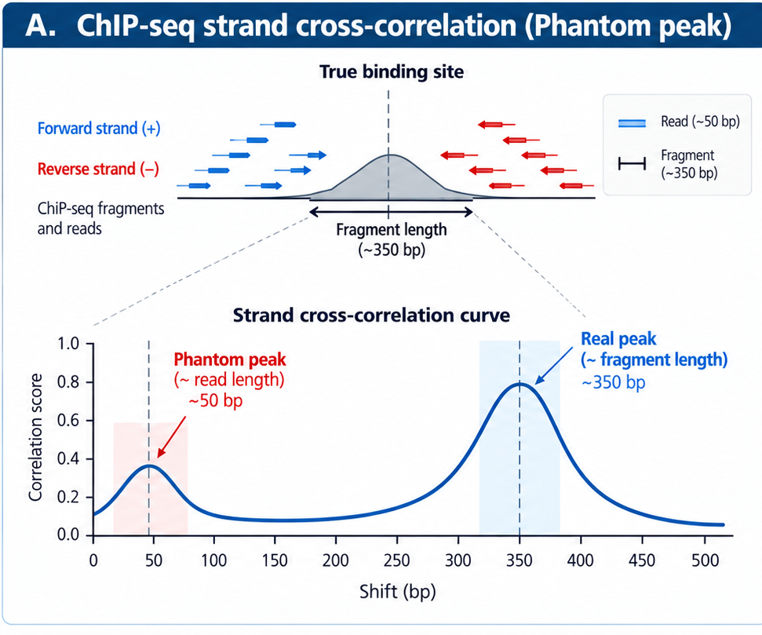
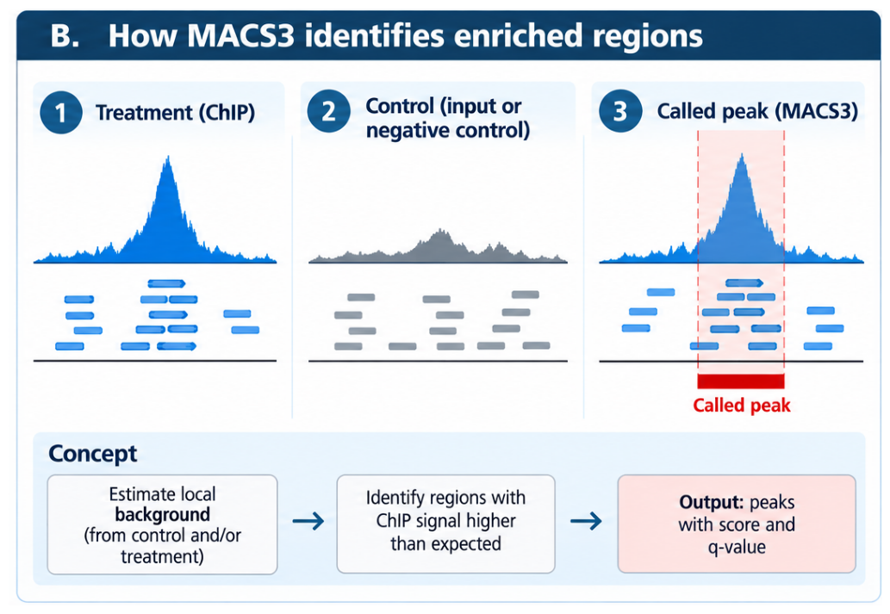

## 1. Before we start

Work from the root of your own `workshop_ngs` repository:

```bash
cd ~/workshop_ngs
pwd
```

The final component of `pwd` should be `workshop_ngs`.

Day 3 starts from the trimmed ChIP-seq FASTQ files created on Day 1:

```text
results/day1_qc/trimmed_fastq/chipseq/
```

Check the FASTQ files, reference genome and Bowtie2 index:

```bash
ls -lh results/day1_qc/trimmed_fastq/chipseq/*.trimmed.fastq.gz
ls -lh reference_genome/genome.fa
ls -lh reference_genome/bowtie2_index/genome*.bt2
grep '^>' reference_genome/genome.fa | grep 'NZ_AP026446.1'
```

The same `GCF_025998455.1` reference assembly must be used for RNA-seq, ChIP-seq, peak annotation and the optional Day 4 integration.

## 2. Overview of the day

Today we reuse the mapping logic from Day 2, then introduce ChIP-seq-specific quality control, peak calling, replicate reproducibility and differential occupancy analysis.

```{mermaid}
flowchart TD
    fastq["Trimmed paired-end ChIP-seq FASTQ"]
    mapping["Bowtie2 mapping"]
    bam["Sorted + filtered BAM"]
    alignqc["Multi-mapping + duplicate QC"]
    strandqc["Cross-correlation + paired-end fragment size"]
    bigwig["CPM fragment-coverage bigWig tracks"]
    macs3["Comparison route: MACS3 without control"]
    macs3ko["Primary route: WT/WTS vs matched ΔHP1021 control"]
    idr["IDR: peak reproducibility"]
    cor["Replicate signal correlation"]
    frip["FRiP: fraction of fragments in peaks"]
    peaks["FDR-filter peak calls + merge consensus"]
    counts["Count all 12 libraries in common peaks"]
    deseq2["DESeq2 peak-count analysis"]
    plots["genomation metaplots + heatmaps"]
    fasta["Extract two selected peak sets"]
    streme["STREME de novo motifs"]

    fastq --> mapping
    mapping --> bam
    bam --> alignqc
    alignqc --> strandqc
    strandqc --> bigwig
    bigwig --> macs3ko
    bigwig -.-> macs3
    macs3ko --> idr
    idr --> cor
    cor --> frip
    frip --> peaks
    peaks --> counts
    counts --> deseq2
    deseq2 --> plots
    deseq2 --> fasta
    fasta --> streme
```

The teaching sequence is therefore:

1. map and filter reads;
2. assess mapping ambiguity and coordinate duplication;
3. assess ChIP fragment structure with strand cross-correlation and paired-end fragment lengths;
4. make fragment-coverage tracks;
5. call peaks through two MACS3 routes: a no-control comparison and the primary matched ΔHP1021 target-negative-control route;
6. perform three complementary post-peak QC checks: IDR, replicate signal correlation and FRiP;
7. merge significant matched-control peaks into one common peak set;
8. count all twelve WT/WTS/ΔHP1021/ΔHP1021S samples over the same genomic intervals;
9. in one R script, inspect pair-wise normalized counts and PCA, fit DESeq2 models, inspect dispersion/MA plots, and save the WT-specific and treatment-responsive peak sets;
10. visualize ChIP-seq signal around peaks;
11. extract the two selected peak sets and perform de novo motif discovery with STREME.

This order separates distinct QC questions:

```text
Does one library show the expected strand-shift enrichment structure? -> strand cross-correlation
Are ranked peak calls reproducible between biological replicates?      -> IDR
Do replicate genomic signal profiles agree globally?                   -> replicate correlation
What fraction of usable fragments falls inside called peaks?           -> FRiP
Do common peak counts show sensible sample structure?                   -> PCA
Which common peaks change by condition?                                 -> DESeq2
```

::: {.callout-warning title="Workshop analysis, not a reproduction of the paper"}
The publication and this workshop do not use the same reference or statistical workflow. All available ChIP-seq libraries are mapped to `GCF_025998455.1`. We now carry two peak-calling routes in parallel: (1) no external control and (2) WT/WTS treatment libraries called against their matched ΔHP1021/ΔHP1021S target-negative ChIP controls. These are teaching analyses, not a reproduction of the published peak coordinates or biological conclusions.
:::

Prepare the folders:

```bash
mkdir -p scripts/day3_chipseq
mkdir -p results/day3_chipseq/bam
mkdir -p results/day3_chipseq/qc/duplicates
mkdir -p results/day3_chipseq/qc/phantom_peak
mkdir -p results/day3_chipseq/qc/fragment_size
mkdir -p results/day3_chipseq/qc/idr/wt_vs_delta
mkdir -p results/day3_chipseq/qc/replicate_correlation
mkdir -p results/day3_chipseq/qc/frip
mkdir -p results/day3_chipseq/qc/peak_counts
mkdir -p results/day3_chipseq/bigwig
mkdir -p results/day3_chipseq/peaks/no_input
mkdir -p results/day3_chipseq/peaks/wt_vs_delta/untreated
mkdir -p results/day3_chipseq/peaks/wt_vs_delta/treated
mkdir -p results/day3_chipseq/peaks/consensus
mkdir -p results/day3_chipseq/counts
mkdir -p results/day3_chipseq/differential_peaks
mkdir -p results/day3_chipseq/genomation
mkdir -p results/day3_chipseq/motifs/streme
mkdir -p results/logs/day3
```

## 3. Map and filter the ChIP-seq reads

ChIP-seq reads come from genomic DNA fragments recovered by immunoprecipitation. Mapping asks where those fragments originate on the reference genome.

We use [Bowtie2](https://bowtie-bio.sourceforge.net/bowtie2/manual.shtml) to align the paired-end reads and [SAMtools](https://www.htslib.org/doc/samtools.html) to convert, sort, filter and index the alignments. These are the same basic alignment objects introduced on Day 2.

The transformation is:

```text
paired FASTQ
  -> Bowtie2 alignments
  -> temporary SAM
  -> coordinate-sorted BAM
  -> filtered BAM
  -> BAM index and mapping summaries
```

The sorted BAM preserves the complete mapped library. The filtered BAM is the working file for ChIP-seq QC, coverage tracks, peak calling and peak counting.

### 3.1 Mapping and filtering script

Create `scripts/day3_chipseq/01_map_bowtie2_sort_filter.sh`:

```bash
nano scripts/day3_chipseq/01_map_bowtie2_sort_filter.sh
```

Paste:

```bash
#!/usr/bin/env bash
set -euo pipefail

fastq_dir="results/day1_qc/trimmed_fastq/chipseq"
index_prefix="reference_genome/bowtie2_index/genome"
bam_dir="results/day3_chipseq/bam"
log_dir="results/logs/day3"

mkdir -p "${bam_dir}" "${log_dir}"

for read1 in "${fastq_dir}"/*_R1.trimmed.fastq.gz
do
  read2="${read1/_R1.trimmed.fastq.gz/_R2.trimmed.fastq.gz}"
  sample_id="$(basename "${read1}" _R1.trimmed.fastq.gz)"
  sam_file="${bam_dir}/${sample_id}.sam"
  sorted_bam="${bam_dir}/${sample_id}.sorted.bam"
  filtered_bam="${bam_dir}/${sample_id}.filtered.bam"

  bowtie2 \
    -x "${index_prefix}" \
    -1 "${read1}" \
    -2 "${read2}" \
    -p 2 \
    -S "${sam_file}" \
    2> "${log_dir}/${sample_id}.bowtie2.log"

  samtools sort \
    -@ 2 \
    -O BAM \
    -o "${sorted_bam}" \
    "${sam_file}"

  samtools index "${sorted_bam}"
  samtools flagstat "${sorted_bam}" > "${log_dir}/${sample_id}.flagstat.txt"

  samtools view \
    -@ 2 \
    -b \
    -q 10 \
    -f 2 \
    -F 2828 \
    -o "${filtered_bam}" \
    "${sorted_bam}"

  samtools index "${filtered_bam}"
  samtools flagstat "${filtered_bam}" > "${log_dir}/${sample_id}.filtered.flagstat.txt"

  rm -f "${sam_file}"
done
```

Run it:

```bash
docker run --rm \
  --user "$(id -u):$(id -g)" \
  -v "$PWD:/work" \
  -w /work \
  docker.io/fgualdr/ngs-bowtie2-samtools \
  bash scripts/day3_chipseq/01_map_bowtie2_sort_filter.sh
```

Check:

```bash
ls -lh results/day3_chipseq/bam/*.sorted.bam
ls -lh results/day3_chipseq/bam/*.filtered.bam
cat results/logs/day3/*.bowtie2.log
cat results/logs/day3/*.filtered.flagstat.txt
```

### 3.2 What the filter means

The key command is:

```bash
samtools view -b -q 10 -f 2 -F 2828
```

| Option | Meaning here |
|---|---|
| `-b` | write BAM output |
| `-q 10` | require mapping quality of at least 10 |
| `-f 2` | retain alignments belonging to properly paired fragments |
| `-F 2828` | remove unmapped, mate-unmapped, secondary, failed-QC and supplementary records |

`samtools sort` accepts SAM directly and writes coordinate-sorted BAM; `-O BAM` simply makes the output format explicit. The `-b` option belongs to `samtools view`, not to `samtools sort`.

The filter does **not** remove duplicate-marked reads (`0x400`). It also does not define unique mapping by SAM FLAG alone: Bowtie2 can report one primary placement for an ambiguous read and represent confidence through MAPQ. We therefore treat **duplication and multi-mapping as explicit ChIP-seq QC questions** before peak calling.

## 4. Quality control of mapped ChIP-seq libraries

ChIP-seq QC is not one number. We combine several pieces of evidence:

| Question | Evidence |
|---|---|
| Did the reads map to the intended reference? | Bowtie2 log and `samtools flagstat` |
| How much alignment ambiguity remains? | Bowtie2 multi-mapping summary + MAPQ filtering |
| Is coordinate duplication unusually high? | `samtools markdup` duplicate summary |
| Are the paired fragments plausible? | proper-pair rate and fragment-size summaries |
| Does the library contain strand-shift enrichment structure? | strand cross-correlation |
| Is enrichment visible as genomic signal? | CPM bigWig tracks |
| Do biological replicates reproduce peak calls? | IDR after peak calling |
| Do replicate signal profiles agree genome-wide? | deepTools replicate correlation after peak calling |
| Is ChIP signal concentrated in called peaks? | FRiP after peak calling |

### 4.1 ChIP-seq-specific QC: multi-mapping and duplication

The same BAM concepts used for RNA-seq apply here, but their **biological consequences are different**. In ChIP-seq, local read pileups are themselves the signal used for peak calling. Repetitive alignments or PCR-amplified fragments can therefore create or exaggerate apparent enrichment.

We ask two questions before peak calling:

1. **How much alignment ambiguity is present?** Repetitive reads can map to several genomic positions and can create misleading signal in repetitive regions.
2. **How much coordinate duplication is present?** Excessive PCR duplication can artificially increase a local ChIP pileup.

Neither measurement should be interpreted in isolation. Genuine strong binding events can also produce many overlapping fragments, particularly in a small bacterial genome.

#### Multi-mapping with Bowtie2

Bowtie2 reports paired-end mapping categories in the log generated during Section 3.1. In particular:

```text
aligned concordantly 1 time
aligned concordantly >1 times
```

Inspect these categories across all ChIP-seq libraries:

```bash
grep -E \
  "aligned concordantly 1 time|aligned concordantly >1 times" \
  results/logs/day3/*.bowtie2.log
```

Bowtie2 can also write `AS:i` for the selected alignment score and `XS:i` when an alternative alignment was found. However, `XS` is **not** a universal unique/multi-mapping flag: absence of `XS` does not prove that no alternative genomic placement exists. Bowtie2 summarizes its confidence in the reported placement through **MAPQ**.

Our standard ChIP-seq filter therefore uses:

```bash
samtools view -b -q 10 -f 2 -F 2828
```

The `-q 10` criterion removes low-confidence alignments, while `-f 2` requires the original alignment to be a proper pair and `-F 2828` removes unmapped, mate-unmapped, secondary, failed-QC and supplementary records. Removing secondary records (`0x100`) alone would **not** remove all multimapping reads.

::: {.callout-note title="Paired-end filtering"}
`samtools view` applies MAPQ filtering to individual BAM records. The `0x2` proper-pair FLAG describes the original Bowtie2 alignment; it does not guarantee that both mates remain after an additional record-level MAPQ filter. For this workshop we keep the simple, transparent filter used in Section 3.1. A production workflow requiring strictly complete post-filter pairs should use a pair-aware filtering strategy and verify the retained fragment pairs before peak calling.
:::

For standard transcription-factor ChIP-seq, confidently mapped reads are usually preferred because ambiguous placements can generate false enrichment. If the biological question instead concerns repetitive DNA, transposable elements or multicopy loci, multimappers may be informative and should be handled with a repeat-aware strategy rather than discarded automatically.

#### Measure coordinate duplication

For ChIP-seq, duplicate assessment is particularly important because peak calling depends on local fragment depth. We use `samtools markdup` to **mark and measure** coordinate duplicates without changing the standard BAMs used elsewhere in the workshop.

Create `scripts/day3_chipseq/02_duplicate_qc.sh`:

```bash
nano scripts/day3_chipseq/02_duplicate_qc.sh
```

Paste:

```bash
#!/usr/bin/env bash
set -euo pipefail

bam_dir="results/day3_chipseq/bam"
qc_dir="results/day3_chipseq/qc/duplicates"
log_dir="results/logs/day3"

mkdir -p "${qc_dir}/marked" "${qc_dir}/tmp" "${log_dir}"

printf 'sample\tprimary_mapped_records\tduplicate_records\tduplicate_percent\n' \
  > "${qc_dir}/duplicate_summary.tsv"

for bam in "${bam_dir}"/*.filtered.bam; do
  [[ -e "${bam}" ]] || continue

  sample="$(basename "${bam}" .filtered.bam)"
  echo "Duplicate QC: ${sample}"

  samtools sort -n -@ 2 \
    -o "${qc_dir}/tmp/${sample}.name.bam" \
    "${bam}"

  samtools fixmate -m \
    "${qc_dir}/tmp/${sample}.name.bam" \
    "${qc_dir}/tmp/${sample}.fixmate.bam"

  samtools sort -@ 2 \
    -o "${qc_dir}/tmp/${sample}.position.bam" \
    "${qc_dir}/tmp/${sample}.fixmate.bam"

  samtools markdup -s \
    "${qc_dir}/tmp/${sample}.position.bam" \
    "${qc_dir}/marked/${sample}.marked.bam" \
    2> "${log_dir}/${sample}.markdup.log"

  samtools index "${qc_dir}/marked/${sample}.marked.bam"

  total=$(samtools view -c -F 2308 \
    "${qc_dir}/marked/${sample}.marked.bam")

  duplicates=$(samtools view -c -f 1024 -F 2308 \
    "${qc_dir}/marked/${sample}.marked.bam")

  awk -v s="${sample}" -v n="${total}" -v d="${duplicates}" \
    'BEGIN {printf "%s\t%d\t%d\t%.2f\n", s,n,d,(n>0 ? 100*d/n : 0)}' \
    >> "${qc_dir}/duplicate_summary.tsv"

  # Optional sensitivity-analysis BAM: remove records marked with FLAG 0x400.
  samtools view -@ 2 -b -F 1024 \
    -o "${bam_dir}/${sample}.dedup.bam" \
    "${qc_dir}/marked/${sample}.marked.bam"

  samtools index "${bam_dir}/${sample}.dedup.bam"
done

rm -rf "${qc_dir}/tmp"
column -t "${qc_dir}/duplicate_summary.tsv"
```

Run it with the existing Bowtie2/SAMtools image:

```bash
docker run --rm \
  --user "$(id -u):$(id -g)" \
  -v "$PWD:/work" \
  -w /work \
  docker.io/fgualdr/ngs-bowtie2-samtools \
  bash scripts/day3_chipseq/02_duplicate_qc.sh
```

Inspect:

```bash
column -t results/day3_chipseq/qc/duplicates/duplicate_summary.tsv
```

Here the duplicate FLAG (`0x400`) is used only **after** `samtools markdup` has identified coordinate duplicates. The `*.marked.bam` files retain the duplicate flags for QC, while the same script also writes optional `*.dedup.bam` files with `0x400` records removed. The original `*.filtered.bam` files remain unchanged.

#### Should ChIP-seq duplicates be removed?

This decision differs from RNA-seq. In RNA-seq, highly expressed transcripts naturally produce many fragments from the same genomic region, so coordinate deduplication can strongly bias expression estimates. In ChIP-seq, by contrast, PCR-amplified fragments can directly create an artificial local pileup and therefore an artificial peak.

However, blindly removing every repeated coordinate can also be too aggressive: a strong, narrow ChIP enrichment can generate genuinely independent fragments with identical coordinates. This is especially plausible for a small genome and a transcription factor with sharply localized binding.

For the **main workshop route**, we therefore:

- measure and compare duplicate rates across replicates;
- inspect whether high duplication coincides with abnormal peak spikes, poor replicate agreement or other QC problems;
- retain the existing `*.filtered.bam` files;
- call MACS3 with `--keep-dup all`, making this choice explicit and consistent.

The duplicate-QC script already creates `*.dedup.bam` files as an **optional sensitivity-analysis product**. They are not used by the canonical workflow. If the deduplicated route is explored, use the deduplicated BAMs **consistently for WT/WTS treatment samples and their matched ΔHP1021/ΔHP1021S controls**, and do not interpret the resulting peak counts or FRiP values as directly interchangeable with those from the duplicate-retaining route.

::: {.callout-important title="Workshop decision"}
The canonical Day 3 analysis continues with `*.filtered.bam`: MAPQ-filtered, primary proper-pair alignments with duplicates retained. The duplicate-marked and optional `*.dedup.bam` files are QC/sensitivity-analysis products. This keeps bigWigs, MACS3, replicate correlation, FRiP and `bedtools multicov` based on one consistent definition of a usable fragment.
:::

### 4.2 Strand cross-correlation: the idea

For a narrow ChIP-seq binding event, DNA fragments overlap the bound locus. The 5′ ends of reads mapping to the `+` strand tend to accumulate on one side of the event, while reads mapping to the `-` strand tend to accumulate on the other side.

Strand cross-correlation asks how similar those two strand-specific read-start profiles become when one profile is shifted relative to the other:

1. keep the `+`-strand profile fixed;
2. shift the `-`-strand profile by increasing distances;
3. calculate the correlation at each shift;
4. inspect where the correlation reaches local maxima.

{#fig-phantom-peak width="100%" fig-alt="Forward and reverse strand read starts around a ChIP binding event and a schematic cross-correlation curve with read-length and fragment-length peaks."}

Two positions on the curve are particularly useful:

- the **phantom peak**, usually close to the sequencing read length;
- the **fragment-length peak**, near the characteristic separation of the two sides of enriched ChIP fragments.

For example, with 50 bp reads from a library whose sonicated fragments are around 350 bp, the phantom peak is expected near 50 bp and the enrichment-associated fragment peak near 350 bp.

A library with clear enrichment usually shows a fragment-length peak that rises above the read-length phantom structure. This is a QC pattern, not an absolute biological rule: low-complexity experiments or proteins with very few genuine binding sites can also produce modest cross-correlation values.

The commonly reported quantities are:

| Quantity | Interpretation |
|---|---|
| `estFragLen` | shift of the strongest non-phantom cross-correlation peak |
| `phantomPeak` | read-length-associated peak position |
| `NSC` | correlation at the fragment peak divided by the minimum cross-correlation |
| `RSC` | fragment-peak enrichment above the minimum, relative to the phantom-peak enrichment above the minimum |
| `QualityTag` | thresholded summary derived from RSC; useful as a warning flag, not as the complete QC decision |

::: {.callout-note title="Paired-end interpretation"}
For paired-end data, the physical fragment boundaries are already defined by the two mates. MACS3 `BAMPE` therefore does **not** need the cross-correlation estimate in order to reconstruct fragment length. We use strand cross-correlation as an independent measure of enrichment structure and library quality.
:::

### 4.3 `phantompeakqualtools`

We calculate strand cross-correlation with [`phantompeakqualtools`](https://github.com/kundajelab/phantompeakqualtools), the Kundaje Lab implementation widely used in ENCODE-style ChIP-seq QC. The tool is built around the SPP strand cross-correlation framework described by Kharchenko, Tolstorukov and Park (2008) and the ENCODE ChIP-seq QC recommendations of Landt *et al.* (2012).

Its main script, `run_spp.R`, reads mapped tags, constructs strand-specific read-start profiles, evaluates their cross-correlation over a range of shifts and reports the fragment peak, phantom peak, NSC, RSC and quality tag. With `-savp` it also writes a **PDF cross-correlation curve** for visual inspection.

The original method was developed around tag/read starts. For our paired-end data, the directly observed mate-to-mate fragment length remains the physical fragment definition; we use cross-correlation as an **independent enrichment-structure QC measurement**. We use only the QC functionality of `phantompeakqualtools`; peak calling in this workshop is performed with MACS3.

Create `scripts/day3_chipseq/02_phantom_peak_qc.sh`:

```bash
nano scripts/day3_chipseq/02_phantom_peak_qc.sh
```

Paste:

```bash
#!/usr/bin/env bash
set -euo pipefail

bam_dir="results/day3_chipseq/bam"
out_dir="results/day3_chipseq/qc/phantom_peak"
log_dir="results/logs/day3"
work_dir="$PWD"
summary_file="${out_dir}/phantom_peak_summary.tsv"

mkdir -p "${out_dir}" "${log_dir}"

printf 'filename\tnumReads\testFragLen\tcorr_estFragLen\tphantomPeak\tcorr_phantomPeak\targmin_corr\tmin_corr\tNSC\tRSC\tQualityTag\n' > "${summary_file}"

for bam in "${bam_dir}"/*.filtered.bam
do
  sample_id="$(basename "${bam}" .filtered.bam)"
  sample_dir="${out_dir}/${sample_id}"
  qc_file="${sample_dir}/${sample_id}.phantom_peak_qc.tsv"

  mkdir -p "${sample_dir}"
  rm -f "${qc_file}"

  Rscript "$(command -v run_spp.R)" \
    -c="${work_dir}/${bam}" \
    -p=2 \
    -savp \
    -rf \
    -odir="${work_dir}/${sample_dir}" \
    -tmpdir="${work_dir}/${sample_dir}" \
    -out="${work_dir}/${qc_file}" \
    > "${log_dir}/${sample_id}.phantom_peak.log" 2>&1

  cat "${qc_file}" >> "${summary_file}"
done
```

Run:

```bash
docker run --rm \
  --user "$(id -u):$(id -g)" \
  --platform linux/amd64 \
  -v "$PWD:/work" \
  -w /work \
  docker.io/fgualdr/ngs-phantompeakqualtools:latest \
  bash scripts/day3_chipseq/02_phantom_peak_qc.sh
```

Inspect the summary and the PDF curves:

```bash
column -t -s $'\t' results/day3_chipseq/qc/phantom_peak/phantom_peak_summary.tsv
find results/day3_chipseq/qc/phantom_peak -name '*.pdf' | sort
```

Interpret the cross-correlation curve together with mapping rate, read depth, replicate behaviour, bigWig signal and later peak calls rather than using a single historical threshold as a pass/fail rule.

### 4.4 Use paired-end information to check the physical fragment length

`phantompeakqualtools` is a **general ChIP-seq QC method** based on strand cross-correlation. It is useful for both single-end and paired-end experiments because it asks whether the `+`- and `-`-strand read-start profiles contain the characteristic displacement expected around enriched fragments.

However, paired-end sequencing gives us an additional piece of information that single-end sequencing does not: **both ends of each sequenced DNA fragment are observed directly**. We can therefore estimate the physical fragment-size distribution from the paired alignments themselves and use it as an independent check of the cross-correlation result.

This is particularly useful for our libraries because the reads are approximately **150 bp long**. If the physical fragments are around 200 bp, the expected read-length-associated phantom structure (~150 bp) and the fragment-length signal (~200 bp) are separated by only ~50 bp. The two features may therefore merge into one broad cross-correlation peak rather than appearing as two clearly resolved maxima.

::: {.callout-important title="Cross-correlation versus paired-end fragment length"}
The two measurements answer related but different questions:

- **phantompeakqualtools:** does the library show the expected strand-shift enrichment structure?
- **paired-end TLEN:** what fragment sizes were actually observed between the two mapped mates?

For paired-end data, the TLEN distribution provides the more direct estimate of physical fragment size. Cross-correlation remains useful as an independent enrichment/QC measurement.
:::

In a SAM/BAM file, column 9 (`TLEN`, template length) records the inferred template length for a paired alignment. The two mates carry values with opposite signs, so we use only records with **positive TLEN** to count each fragment once.

Create `scripts/day3_chipseq/02b_pe_fragment_size_qc.sh`:

```bash
nano scripts/day3_chipseq/02b_pe_fragment_size_qc.sh
```

Paste:

```bash
#!/usr/bin/env bash
set -euo pipefail

bam_dir="results/day3_chipseq/bam"
out_dir="results/day3_chipseq/qc/fragment_size"

mkdir -p "${out_dir}"

summary="${out_dir}/fragment_size_summary.tsv"
printf 'sample\tn_fragments\tmean_bp\tmedian_bp\tq25_bp\tq75_bp\n' > "${summary}"

for bam in "${bam_dir}"/*.filtered.bam
do
  sample="$(basename "${bam}" .filtered.bam)"
  lengths="${out_dir}/${sample}.fragment_lengths.txt"

  echo "Fragment-size QC: ${sample}"

  # Keep one record per proper pair and use positive TLEN only.
  # The BAMs are already MAPQ-filtered primary alignments from Section 4.1.
  samtools view -f 2 "${bam}" | \
    awk '$9 > 0 {print $9}' | \
    sort -n > "${lengths}"

  awk -v sample="${sample}" '
    {
      x[++n]=$1
      sum+=$1
    }
    END {
      if (n == 0) {
        printf "%s\t0\tNA\tNA\tNA\tNA\n", sample
        exit
      }

      q25=x[int((n-1)*0.25)+1]
      med=x[int((n-1)*0.50)+1]
      q75=x[int((n-1)*0.75)+1]

      printf "%s\t%d\t%.1f\t%d\t%d\t%d\n", \
             sample,n,sum/n,med,q25,q75
    }
  ' "${lengths}" >> "${summary}"
done
```

Run the script with the same workshop samtools image used for BAM processing:

```bash
docker run --rm \
  --user "$(id -u):$(id -g)" \
  -v "$PWD:/work" \
  -w /work \
  docker.io/fgualdr/ngs-bowtie2-samtools:latest \
  bash scripts/day3_chipseq/02b_pe_fragment_size_qc.sh
```

Inspect the fragment-size summary:

```bash
column -t -s $'\t' results/day3_chipseq/qc/fragment_size/fragment_size_summary.tsv
```

For one sample, inspect the most frequent fragment lengths:

```bash
sort -n results/day3_chipseq/qc/fragment_size/WT_1.fragment_lengths.txt | \
  uniq -c | \
  sort -nr | \
  head
```

The individual fragment-length files can also be plotted later in R if we want to inspect the complete distribution.

#### How do we combine the two QC measurements?

Suppose a library contains 150-bp reads and `phantompeakqualtools` reports a dominant cross-correlation feature around 200 bp. If the paired-end TLEN distribution independently has its main fragment-size mass around ~200 bp, this strongly supports interpreting the ~200-bp cross-correlation feature as the physical fragment-length signal.

If the TLEN distribution instead centres close to the read length, or is very broad, then the read-length phantom structure and fragment-length structure may not be cleanly distinguishable in the cross-correlation curve. In that situation, **do not force an interpretation from NSC, RSC or `QualityTag` alone**.

For this bacterial paired-end ChIP-seq experiment, use the two measurements together:

```text
strand cross-correlation
        +
paired-end TLEN distribution
        |
        v
fragment-size / enrichment interpretation
        |
        v
combine with duplication, mapping QC, IDR, FRiP and signal tracks
```

The paired-end fragment-size estimate is also directly relevant to MACS3: when we call peaks with `-f BAMPE`, MACS3 uses the observed paired-end fragment boundaries rather than requiring a fragment length inferred from strand cross-correlation.

### 4.5 Make CPM-normalized fragment coverage with `bamCoverage`

[`bamCoverage`](https://deeptools.readthedocs.io/en/latest/content/tools/bamCoverage.html) from deepTools converts BAM alignments into an indexed bigWig signal track.

For paired-end ChIP-seq we want **fragment coverage** rather than two independent read tracks:

- `--extendReads` uses the mate positions to represent the complete paired-end fragment;
- `--samFlagInclude 64` keeps only read 1 as the representative BAM record, so that the same physical fragment is not added twice;
- `--normalizeUsing CPM` scales the track by the number of mapped observations used to generate the signal.

Create `scripts/day3_chipseq/03_make_cpm_bigwigs.sh`:

```bash
nano scripts/day3_chipseq/03_make_cpm_bigwigs.sh
```

Paste:

```bash
#!/usr/bin/env bash
set -euo pipefail

bam_dir="results/day3_chipseq/bam"
out_dir="results/day3_chipseq/bigwig"

mkdir -p "${out_dir}"

for bam in "${bam_dir}"/*.filtered.bam
do
  sample_id="$(basename "${bam}" .filtered.bam)"

  bamCoverage \
    -b "${bam}" \
    -o "${out_dir}/${sample_id}.cpm.bw" \
    --normalizeUsing CPM \
    --binSize 10 \
    --extendReads \
    --samFlagInclude 64 \
    --numberOfProcessors 2
done
```

Run:

```bash
docker run --rm \
  --user "$(id -u):$(id -g)" \
  -v "$PWD:/work" \
  -w /work \
  docker.io/fgualdr/ngs-deeptools \
  bash scripts/day3_chipseq/03_make_cpm_bigwigs.sh
```

Check:

```bash
ls -lh results/day3_chipseq/bigwig/*.cpm.bw
```

Open the tracks in IGV and compare the same loci across all replicates. Look for localized enrichment, agreement between replicates and samples that are unusually flat or noisy.

## 5. Call peaks with MACS3

Peak calling converts a continuous ChIP-seq enrichment signal into genomic intervals whose signal is unlikely to be explained by the estimated background alone.

We use [`MACS3 callpeak`](https://macs3-project.github.io/MACS/docs/callpeak.html), the current implementation of the MACS peak-calling framework.

{#fig-macs3-concept width="100%" fig-alt="Paired-end fragments form a pileup, are compared with background, and are grouped into significant peak intervals with summits."}

### 5.1 From a paired-end BAM to a peak

For paired-end ChIP-seq, MACS3 can be understood as four linked operations:

1. **Build the observed ChIP signal.** With `-f BAMPE`, each properly mapped read pair already defines the physical DNA fragment. MACS3 piles up those observed fragments across the genome to obtain the treatment signal, $k(x)$.
2. **Build an expected background.** MACS3 calculates an expected count, $\lambda(x)$, representing how much signal could plausibly occur without specific enrichment. The source of this background depends on whether a control is supplied; this is explained in Section 5.2.
3. **Score enrichment across the genome.** At each genomic position, the observed treatment pileup is compared with the expected background using a local Poisson model. This produces a genome-wide p-value score track, which MACS3 converts to q-values when peak calling is performed with `-q`.
4. **Turn the score track into genomic intervals.** MACS3 keeps regions above the selected score threshold, merges nearby significant segments when the intervening gap is sufficiently short, rejects regions shorter than the minimum peak length, and reports the resulting intervals as peaks. With `--call-summits`, local maxima inside those intervals are also reported.

```text
paired-end BAM
      |
      v
observed fragments -> treatment pileup k(x)
      |
      +-----------------------------+
                                    |
background model -> lambda(x)       |
      |                             |
      +---------- compare ----------+
                  |
                  v
          Poisson p-value track
                  |
                  v
              q-values
                  |
                  v
      threshold + join nearby regions
                  |
                  v
        peak start -- summit -- peak end
                  |
                  v
              narrowPeak
```

::: {.callout-important title="MACS3 isliding"}
The fragment length contributes to the treatment/background model and, by default, to the **minimum allowed peak length**. Peak boundaries come from contiguous parts of the statistical score track that pass the selected cutoff. The default maximum gap used to join nearby significant segments is based on the detected read length, whereas the default minimum peak length is based on $d$.
:::

#### What happens to the MACS shifting model with paired-end data?

The original MACS model was designed for single-end ChIP-seq. Plus- and minus-strand read starts form two displaced clouds around a binding event like the Phantompeak QC step!, and MACS estimates their separation to infer the fragment length and shift the tags appropriately.

With `-f BAMPE`, that inference is unnecessary for the treatment pileup: the two mates already define the complete fragment. MACS3 therefore enters its paired-end mode and uses the **actual insert sizes of read pairs** rather than building the single-end bimodal shifting model.

::: {.callout-note title="`--nomodel` is not the same as `--nolambda`"}
`--nomodel` tells MACS3 to bypass the **single-end shifting model** and normally goes together with a user-specified `--extsize` (and, when appropriate, `--shift`). It is mainly relevant when analysing reads as single-end tags.

For this workshop we use `-f BAMPE`, so the paired-end fragment coordinates are already known and adding `--nomodel` is unnecessary.

`--nolambda`, discussed below, is completely different: it changes how MACS3 estimates the **background** used for the Poisson test.
:::

MACS3 derives q-values from the genome-wide p-value distribution using the Benjamini-Hochberg procedure. The final `narrowPeak` interval is therefore a **model-derived enriched region**, not a directly observed object.

### 5.2 Where does the background lambda come from?

The central statistical comparison is between the observed treatment pileup, $k(x)$, and an expected background, $\lambda(x)$:

$$
X \sim Poisson(\lambda(x))
$$

MACS3 asks how surprising the observed pileup is under that background model. A large treatment pileup relative to $\lambda(x)$ produces a small p-value.

The important point is that **the source of $\lambda$ changes depending on whether an external control is supplied**.

#### Case 1: a control is supplied with `-c`

With an input, mock-IP or other control library, the treatment and control have different roles:

```text
ChIP BAM ------------------------------> observed pileup k(x)

Control BAM
   |-- whole-genome background   lambda_BG
   |-- fragment-scale background lambda_d
   |-- 1 kb local background     lambda_slocal
   `-- 10 kb local background    lambda_llocal
                         |
                         v
                  lambda_local(x)
```

The genome-wide component is approximately:

$$
\lambda_{BG} = \frac{N_{control}\,d}{G_{effective}}
$$

where $N_{control}$ is the number of usable control reads/fragments, $d$ is the characteristic fragment length and $G_{effective}$ is the effective genome size.

MACS3 then estimates control-derived background at several spatial scales. By default these are approximately:

- **fragment scale**, $\lambda_d$;
- **small local window**, $\lambda_{slocal}$, controlled by `--slocal`, default **1000 bp**;
- **large local window**, $\lambda_{llocal}$, controlled by `--llocal`, default **10000 bp**;
- the genome-wide baseline, $\lambda_{BG}$.

At each genomic position, the standard local background is the most conservative of these estimates:

$$
\lambda_{local}(x) = \max\left(\lambda_{BG},\lambda_d(x),\lambda_{slocal}(x),\lambda_{llocal}(x)\right)
$$

The 1 kb and 10 kb windows therefore estimate **background around a genomic position**. They are not the windows that define the final peak boundaries.

Before treatment and control are compared, MACS3 puts the two libraries on a comparable sequencing-depth scale. By default (`--scale-to small`), the larger library is scaled down to the depth of the smaller library.

::: {.callout-note title="Paired-end treatment versus control background"}
With `-f BAMPE`, MACS3 uses the observed paired-end fragments directly for the **treatment pileup**. The average insertion length $d$ is still used when constructing the expected background scale. This distinction is one reason why $d$ remains relevant even though paired-end fragments themselves do not need to be inferred from strand shifts.
:::

#### Case 2: no control is supplied

Without `-c`, there is no independent negative library. MACS3 can still call peaks by deriving the background from the **treatment library itself**:

```text
ChIP BAM
   |-------------------------------> observed pileup k(x)
   |
   `-- also provides information for the background model
```

The approximate genome-wide component now comes from the treatment depth:

$$
\lambda_{BG} = \frac{N_{ChIP}\,d}{G_{effective}}
$$

If local-lambda modelling is left enabled, MACS3 can also derive local bias from the treatment data. This is mathematically possible, but it is not equivalent to having an independent control: the same library contains both the biological enrichment that we are trying to detect and the information being used to estimate local background.

#### Why MACS3 recommends `--nolambda` when no control is available

The current MACS3 documentation notes that `--nolambda` is **particularly recommended when calling peaks without a control sample**. With this option, MACS3 does not use the local 1 kb / 10 kb / fragment-scale bias around candidate peaks. Instead, it uses the background lambda as the local lambda:

$$
\lambda_{local}(x) = \lambda_{BG}
$$

Conceptually:

```text
NO CONTROL, local lambda enabled
ChIP -> treatment pileup
  `--> treatment-derived local background

NO CONTROL + --nolambda
ChIP -> treatment pileup
  `--> genome-wide background lambda_BG
```

This avoids allowing a strong treatment enrichment to contribute to a local background estimate around the same candidate peak. The trade-off is that without a control MACS3 cannot model locus-specific experimental biases that an independent input or negative-control library could reveal.

::: {.callout-important title="Workshop choice"}
For the **primary no-input analysis** in Section 5.4, we do not supply an external `-c` control, so we use `--nolambda`. The statistical comparison in that route is therefore:

```text
observed ChIP pileup k(x)
          versus
genome-wide background lambda_BG
```

This is a transparent no-control teaching analysis, but it is not equivalent to a control-based ChIP-seq experiment. Peak interpretation therefore relies heavily on replicate reproducibility, signal correlation, FRiP, bigWig inspection and biological validation.
:::

The detailed behaviour of these options is described in the MACS3 [`callpeak`](https://macs3-project.github.io/MACS/docs/callpeak.html) documentation and its [step-by-step peak-calling explanation](https://macs3-project.github.io/MACS/docs/Advanced_Step-by-step_Peak_Calling.html).

### 5.3 Where an input or negative control belongs

A control is supplied at the **MACS3 peak-calling step** with `-c`, but choosing the control is first an experimental-design decision: **which sources of background do we want the control to represent?**

| Design | What it contributes | Important limitation |
|---|---|---|
| matched input DNA | fragmentation, mappability, copy-number and general sequencing background before immunoprecipitation | it does not pass through antibody binding, beads, washes or immunoprecipitation |
| mock-IP or IgG ChIP | background generated by the immunoprecipitation procedure | a different antibody can have different affinity and nonspecific-binding behaviour |
| target-negative ChIP, such as an isogenic knockout or deletion | the same antibody and ChIP procedure in material lacking the intended target | deleting the target can alter physiology, chromatin or DNA accessibility |
| no external control | MACS3 can derive background from the treatment; in this workshop `--nolambda` restricts this to the genome-wide background $\lambda_{BG}$ | no locus-specific experimental background is measured, and antibody/IP-specific artefacts are not represented |

#### Equal read depth does not mean equal background information

Input and ChIP libraries are often sequenced to a similar total depth, but they contain very different fragment distributions:

```text
input DNA = fragments distributed broadly across the genome
ChIP DNA  = fragments concentrated at enriched loci
```

An input with the same number of mapped fragments as the ChIP library can therefore still be relatively sparse at any particular locus. MACS3 can scale treatment and control libraries to comparable effective depths, but scaling cannot create local observations that were never sequenced. A shallow input can consequently become the limiting library; the presence of an input file does not automatically guarantee a better local background estimate.

This does **not** make input useless. A sufficiently informative input is valuable for pre-IP biases such as uneven fragmentation, mappability and copy-number effects. The point is that input depth should be chosen for the background it must estimate, rather than automatically matched one-for-one to the IP depth.

#### Input-free calling is not background-free calling

When no external control is supplied, peak calling still requires a null/background expectation. In our workshop that expectation is the treatment-depth-derived genome-wide $\lambda_{BG}$ because `--nolambda` disables the additional treatment-derived local-bias terms. Independent QC therefore becomes especially important:

- mapping quality and library complexity;
- strand cross-correlation;
- pairwise peak reproducibility with IDR;
- replicate signal correlation across genomic bins;
- fraction of usable fragments in called peaks (FRiP);
- sample-level structure of the common peak-count matrix;
- bigWig peak shape and signal-to-noise;
- recovery of plausible sequence motifs;
- consistency with the biological experiment.

::: {.callout-note title="FG personal point of view"}
For a target-specific ChIP experiment, a well-matched **target-negative ChIP** can be more informative than input DNA for distinguishing genuine target-dependent enrichment from antibody- and IP-dependent background, because it passes through the complete immunoprecipitation procedure.

The publication used ΔHP1021 material as a target-negative ChIP control for confirmatory analysis. This is not the same as input DNA, and it is not a perfect control: deleting the target can change the biological state. In a complete experiment, input and target-negative ChIP can be complementary.

The workshop retains this **exploratory no-input analysis** as a teaching comparison. Section 5.5 then introduces the matched WT-versus-ΔHP1021 target-negative route. **From Section 6 onward, the matched-control route is the primary analysis used for IDR, FRiP, consensus construction and differential occupancy.** The no-control calls remain useful for understanding what the control changes, but they are not mixed into the downstream peak universe.
:::

### 5.4 Run MACS3 on each sample

Create `scripts/day3_chipseq/04_call_peaks_macs3.sh`:

```bash
nano scripts/day3_chipseq/04_call_peaks_macs3.sh
```

Paste:

```bash
#!/usr/bin/env bash
set -euo pipefail

bam_dir="results/day3_chipseq/bam"
peak_dir="results/day3_chipseq/peaks/no_input"
log_dir="results/logs/day3"
genome_size="1696601"

mkdir -p "${peak_dir}" "${log_dir}"

for bam in "${bam_dir}"/*.filtered.bam
do
  sample_id="$(basename "${bam}" .filtered.bam)"

  macs3 callpeak \
    -t "${bam}" \
    -f BAMPE \
    -g "${genome_size}" \
    -n "${sample_id}" \
    --outdir "${peak_dir}" \
    --keep-dup all \
    --call-summits \
    --nolambda \
    > "${log_dir}/${sample_id}.macs3.log" 2>&1
done
```

Run:

```bash
docker run --rm \
  --user "$(id -u):$(id -g)" \
  -v "$PWD:/work" \
  -w /work \
  docker.io/fgualdr/ngs-macs3 \
  bash scripts/day3_chipseq/04_call_peaks_macs3.sh
```

Check the peak calls:

```bash
wc -l results/day3_chipseq/peaks/no_input/*_peaks.narrowPeak
```

This **no-input route** makes one MACS3 call per sample and is retained as a comparison showing what MACS3 calls when no external control is supplied. The downstream reproducibility, FRiP and consensus exercises use the matched WT-versus-ΔHP1021 route in Section 5.5. We do not specify `-q` or `-p`, so MACS3 uses its default significance threshold. We retain `--nolambda` here because no external `-c` control is supplied. The separate control-based calls below do **not** use `--nolambda`.

### 5.5 Parallel MACS3 route: WT versus matched ΔHP1021 negative control

The `S` suffix denotes the **S-treated experimental condition**, not an input or negative control. We therefore keep untreated and S-treated libraries separate. If these are **HP1021 ChIP-seq experiments** and ΔHP1021 is the isogenic strain lacking the immunoprecipitated HP1021 target, the ΔHP1021 ChIP libraries can serve as **target-negative immunoprecipitation controls** for WT peak calling.

| WT ChIP (`-t`) | ΔHP1021 ChIP (`-c`) | Experimental condition |
|---|---|---|
| `WT_1.filtered.bam` | `ΔHP1021_1.filtered.bam` | untreated, replicate 1 |
| `WT_2.filtered.bam` | `ΔHP1021_2.filtered.bam` | untreated, replicate 2 |
| `WT_3.filtered.bam` | `ΔHP1021_3.filtered.bam` | untreated, replicate 3 |
| `WTS_1.filtered.bam` | `ΔHP1021S_1.filtered.bam` | S-treated, replicate 1 |
| `WTS_2.filtered.bam` | `ΔHP1021S_2.filtered.bam` | S-treated, replicate 2 |
| `WTS_3.filtered.bam` | `ΔHP1021S_3.filtered.bam` | S-treated, replicate 3 |

::: {.callout-important title="A knockout control is not a genotype differential-binding test"}
Use `-c ΔHP1021` **only if the deletion strain truly lacks the ChIP target**, and the IP and treatment protocols are otherwise comparable. The contrast then asks where the WT ChIP signal exceeds a **target-negative ChIP background**. It does *not* provide a statistical test of differential occupancy between the genotypes. If the ChIP target is a different protein or a histone modification, analyse WT and ΔHP1021 as biological conditions using an appropriate input/mock-IP background and a replicate-aware differential analysis instead.

Here, replicate numbers are used to select corresponding files; they do not imply a paired experimental design unless the samples were collected as matched pairs. If controls are independent, a pooled negative-control design is another defensible approach to consider for a research pipeline.
:::

Create `scripts/day3_chipseq/04b_call_peaks_macs3_wt_vs_delta.sh`:

```bash
nano scripts/day3_chipseq/04b_call_peaks_macs3_wt_vs_delta.sh
```

Paste:

```bash
#!/usr/bin/env bash
set -euo pipefail

bam_dir="results/day3_chipseq/bam"
out_dir="results/day3_chipseq/peaks/wt_vs_delta"
log_dir="results/logs/day3"
genome_size="1696601"

mkdir -p "${out_dir}/untreated" "${out_dir}/treated" "${log_dir}"

for condition in untreated treated; do
  if [[ "${condition}" == "untreated" ]]; then
    wt_prefix="WT"
    delta_prefix="ΔHP1021"
  else
    wt_prefix="WTS"
    delta_prefix="ΔHP1021S"
  fi

  for rep in 1 2 3; do
    wt_bam="${bam_dir}/${wt_prefix}_${rep}.filtered.bam"
    delta_bam="${bam_dir}/${delta_prefix}_${rep}.filtered.bam"
    sample_id="WT_vs_Delta_${condition}_rep${rep}"

    for bam in "${wt_bam}" "${delta_bam}"; do
      if [[ ! -s "${bam}" ]]; then
        echo "ERROR: Missing or empty BAM: ${bam}" >&2
        exit 1
      fi
    done

    echo "Calling ${sample_id}: ${wt_bam} vs ${delta_bam}"

    macs3 callpeak \
      -t "${wt_bam}" \
      -c "${delta_bam}" \
      -f BAMPE \
      -g "${genome_size}" \
      -n "${sample_id}" \
      --outdir "${out_dir}/${condition}" \
      --keep-dup all \
      --call-summits \
      > "${log_dir}/${sample_id}.macs3.log" 2>&1

    echo "Completed ${sample_id}"
  done
done
```

Run using the **same MACS3 container** as in Section 5.4:

```bash
docker run --rm \
  --user "$(id -u):$(id -g)" \
  -v "$PWD:/work" \
  -w /work \
  docker.io/fgualdr/ngs-macs3 \
  bash scripts/day3_chipseq/04b_call_peaks_macs3_wt_vs_delta.sh
```

Inspect the six new peak lists:

```bash
wc -l results/day3_chipseq/peaks/wt_vs_delta/untreated/*_peaks.narrowPeak
wc -l results/day3_chipseq/peaks/wt_vs_delta/treated/*_peaks.narrowPeak
ls -lh results/logs/day3/WT_vs_Delta_*.macs3.log
```

Expected primary outputs (plus MACS3 supplementary files):

```text
results/day3_chipseq/peaks/wt_vs_delta/
├── untreated/
│   ├── WT_vs_Delta_untreated_rep1_peaks.narrowPeak
│   ├── WT_vs_Delta_untreated_rep2_peaks.narrowPeak
│   └── WT_vs_Delta_untreated_rep3_peaks.narrowPeak
└── treated/
    ├── WT_vs_Delta_treated_rep1_peaks.narrowPeak
    ├── WT_vs_Delta_treated_rep2_peaks.narrowPeak
    └── WT_vs_Delta_treated_rep3_peaks.narrowPeak
```

Unlike the no-input command, this call supplies `-c` and **does not include `--nolambda`**. MACS3 can therefore use the ΔHP1021 control signal to estimate locus-dependent background. The existing `-f BAMPE`, `--keep-dup all` and `--call-summits` settings are preserved.

**Interpretation exercise:** For each WT replicate, compare the number and positions of peaks called *without a control* (Section 5.4) and *with the target-negative control* (this section). Does subtracting genotype-matched nonspecific ChIP signal remove questionable peaks while retaining reproducible HP1021-associated enrichment?

::: {.callout-note title="Keep the two peak-calling routes separate"}
From this point onward, use **`peaks/wt_vs_delta/` as the primary peak-calling route**. The no-control calls remain available for comparison, but IDR, FRiP, consensus construction and downstream quantitative analysis are based on the matched WT-versus-ΔHP1021 calls. Do not mix peak lists from the two strategies into one consensus set.
:::

### 5.6 Read a MACS3 `narrowPeak` file

MACS3 writes `narrowPeak` as BED6+4. The first three columns define the genomic interval; the remaining columns describe enrichment and the summit.

| Column | MACS3 meaning |
|---|---|
| 1–3 | chromosome, 0-based start, half-open end |
| 4 | peak name |
| 5 | display score derived from the selected p/q score |
| 6 | strand, usually `.` |
| 7 | fold-enrichment at the peak summit |
| 8 | `-log10(p-value)` at the summit |
| 9 | `-log10(q-value)` at the summit |
| 10 | summit offset from the peak start |

The `peaks/no_input/` files provide the comparison route; the `peaks/wt_vs_delta/` files define the **primary controlled analysis**. Use the controlled peak lists for the IDR/FRiP checks and for the consensus used downstream. Neither MACS3 route sets `-q` or `-p`, so both use the MACS3 default peak-calling significance threshold.

A called interval is a model-derived result, not a directly observed object. Important peaks should still be compared with the CPM bigWigs and replicate behaviour.

## 6. Post-peak quality control

Once MACS3 has produced peak calls, we pause before building the differential-analysis matrix. Three complementary QC measurements answer different questions:

| QC | Main question | Data object |
|---|---|---|
| **IDR** | are the ranked peak calls reproducible between biological replicates? | MACS3 `narrowPeak` lists |
| **replicate signal correlation** | do replicates have similar ChIP-seq signal across the genome? | filtered BAM signal summarized in genomic bins |
| **FRiP** | what fraction of usable paired-end fragments falls inside that sample's called peaks? | filtered BAM + that sample's MACS3 peak set |

These metrics are related but not interchangeable. A sample can have a good FRiP yet disagree with its replicate about *where* the strongest peaks occur, or two replicates can correlate globally while differing in the weakest peak calls.

::: {.callout-note title="Two different uses of the word correlation"}
The **strand cross-correlation** in Section 4 is calculated *within one library* by shifting the `+`- and `-`-strand read-start profiles. The **replicate signal correlation** below compares genomic signal *between samples*. They answer different QC questions.
:::

### 6.1 IDR: reproducibility of ranked peak calls

After peak calling, one key question is whether biological replicates recover a consistent ranked set of enriched regions. We use **Irreproducible Discovery Rate (IDR)** as the formal replicate-level peak reproducibility framework.

A simple first check is the number of peaks called in each sample:

```bash
wc -l results/day3_chipseq/peaks/no_input/*_peaks.narrowPeak
```

Peak counts alone are not enough: two samples can contain similar numbers of peaks but disagree strongly about which regions are strongest. IDR therefore uses the **relative ranking of matched peaks** between two replicate peak lists.

#### IDR concept

We use the [`idr`](https://github.com/kundajelab/idr) implementation distributed through Bioconda/Biocontainers:

```text
docker.io/fgualdr/ngs-idr:latest
```

The statistical framework was introduced by Li, Brown, Huang and Bickel (2011), *Measuring reproducibility of high-throughput experiments*.

An interval overlap asks only:

> Do two peak intervals intersect?

IDR asks a stronger question:

> After matching peaks between replicates, are strong peaks strong in both replicates, and where does that rank agreement begin to break down?

Conceptually, IDR does four things:

1. **matches overlapping peaks** between the two replicate lists;
2. **ranks the matched peaks** using a chosen peak score;
3. fits a two-component model containing a reproducible and an irreproducible component;
4. assigns local and global measures of irreproducibility.

A useful interpretation is:

```text
local IDR  ~ probability that one matched peak pair belongs to the irreproducible component

global IDR ~ cumulative irreproducibility among peaks at least this reproducible
```

IDR is therefore a **rank-reproducibility analysis**, not a differential-binding test and not simply an overlap percentage.

In this workshop we rank the MACS3 `narrowPeak` lists by `p.value` and use a global IDR threshold of `0.05`. For `narrowPeak`, `p.value` refers to the `-log10(p-value)` score in column 8.

::: {.callout-important title="What is simplified here?"}
A formal production IDR workflow is usually built from long, relaxed or near-unthresholded ranked peak lists so that the model can see both the reproducible signal and the weaker tail. To keep this workshop linear, we deliberately reuse the **same MACS3 peak list** produced by the single `callpeak` command.

This is sufficient to teach pairwise rank reproducibility, but it can make IDR less informative if the MACS3 output contains only strong peaks. We also stop short of a full ENCODE-style IDR workflow: we do not add pooled-replicate or pseudo-replicate analyses.
:::

#### Run pairwise IDR

We compare the three biological replicates within each condition:

```text
WT_1  vs WT_2
WT_1  vs WT_3
WT_2  vs WT_3

WTS_1 vs WTS_2
WTS_1 vs WTS_3
WTS_2 vs WTS_3
```

Create `scripts/day3_chipseq/05_idr_pairwise_qc.sh`:

```bash
nano scripts/day3_chipseq/05_idr_pairwise_qc.sh
```

Paste:

```bash
#!/usr/bin/env bash
set -euo pipefail

peak_dir="results/day3_chipseq/peaks/wt_vs_delta"
out_dir="results/day3_chipseq/qc/idr/wt_vs_delta"
log_dir="results/logs/day3"

mkdir -p "${out_dir}" "${log_dir}"

pairs=(
  "untreated:1:2"
  "untreated:1:3"
  "untreated:2:3"
  "treated:1:2"
  "treated:1:3"
  "treated:2:3"
)

for pair in "${pairs[@]}"; do
  IFS=: read -r condition rep1 rep2 <<< "${pair}"

  peak1="${peak_dir}/${condition}/WT_vs_Delta_${condition}_rep${rep1}_peaks.narrowPeak"
  peak2="${peak_dir}/${condition}/WT_vs_Delta_${condition}_rep${rep2}_peaks.narrowPeak"
  prefix="${condition}_rep${rep1}_vs_rep${rep2}"

  idr \
    --samples "${peak1}" "${peak2}" \
    --input-file-type narrowPeak \
    --rank p.value \
    --idr-threshold 0.05 \
    --use-best-multisummit-IDR \
    --plot \
    --output-file "${out_dir}/${prefix}.idr.narrowPeak" \
    --log-output-file "${log_dir}/${prefix}.idr.log"
done
```

Run:

```bash
docker run --rm \
  --user "$(id -u):$(id -g)" \
  --platform linux/amd64 \
  -v "$PWD:/work" \
  -w /work \
  docker.io/fgualdr/ngs-idr:latest \
  bash scripts/day3_chipseq/05_idr_pairwise_qc.sh
```

Inspect:

```bash
ls -lh results/day3_chipseq/qc/idr/wt_vs_delta/*.idr.narrowPeak
ls -lh results/day3_chipseq/qc/idr/wt_vs_delta/*.png
wc -l results/day3_chipseq/qc/idr/wt_vs_delta/*.idr.narrowPeak
```

#### Read the IDR plots

With `--plot`, IDR writes a four-panel PNG for each pair. Because we also use `--use-best-multisummit-IDR`, a second plot ending in `.noalternatesummitpeaks.png` is expected when MACS3 has multi-summit peak groups.

Use the `noalternatesummitpeaks` plot as the main view when it is present.

| Panel | Interpretation |
|---|---|
| upper left | replicate-1 peak rank versus replicate-2 peak rank |
| upper right | replicate-1 versus replicate-2 MACS3 ranking score |
| lower left | replicate-1 rank versus IDR |
| lower right | replicate-2 rank versus IDR |

In the upper panels, reproducible peaks should concentrate around the diagonal. Red points fail the selected IDR threshold. In the lower panels IDR is shown as `-log10(IDR)`, so larger values mean stronger reproducibility:

```text
IDR = 0.05  ->  -log10(IDR) = 1.30
IDR = 0.01  ->  -log10(IDR) = 2.00
IDR = 0.001 ->  -log10(IDR) = 3.00
```

The key question is not whether every pair produces exactly the same number of passing peaks. Ask instead whether the strongest peaks agree between replicates and whether reproducibility deteriorates toward the weaker end of the ranked lists. If nearly all peaks remain reproducible, that can be a genuine property of a small, strong bacterial ChIP-seq peak set rather than an error in the method.

::: {.callout-note title="IDR and the downstream common peak set answer different questions"}
IDR evaluates **replicate reproducibility of ranked peak calls**. The common BED constructed next is a separate object used to place every sample on the same genomic coordinate system for quantitative comparison and DESeq2.
:::

### 6.2 Replicate signal correlation with deepTools

IDR compares **peak lists**. We also want a peak-independent view of whether biological replicates have similar ChIP-seq signal across the genome. A standard approach is to summarize each BAM over the same genomic bins and correlate the resulting vectors.

We use deepTools [`multiBamSummary`](https://deeptools.readthedocs.io/en/latest/content/tools/multiBamSummary.html) followed by [`plotCorrelation`](https://deeptools.readthedocs.io/en/latest/content/tools/plotCorrelation.html). For this small bacterial genome we use 500 bp bins rather than the much larger default bins commonly used for mammalian genomes.

For paired-end data:

- `--extendReads` represents the complete fragment defined by the two mates;
- `--samFlagInclude 64` keeps one representative record per pair, avoiding counting the same fragment twice;
- Spearman correlation compares the ordering of genomic-bin signal and is less dominated by a few extreme bins than Pearson correlation.

Create `scripts/day3_chipseq/05b_replicate_signal_correlation.sh`:

```bash
nano scripts/day3_chipseq/05b_replicate_signal_correlation.sh
```

Paste:

```bash
#!/usr/bin/env bash
set -euo pipefail

bam_dir="results/day3_chipseq/bam"
out_dir="results/day3_chipseq/qc/replicate_correlation"

mkdir -p "${out_dir}"

bam_files=("${bam_dir}"/*.filtered.bam)

multiBamSummary bins \
  --bamfiles "${bam_files[@]}" \
  --smartLabels \
  --binSize 500 \
  --extendReads \
  --samFlagInclude 64 \
  --numberOfProcessors 2 \
  --outFileName "${out_dir}/binned_counts.npz" \
  --outRawCounts "${out_dir}/binned_counts.tsv"

plotCorrelation \
  -in "${out_dir}/binned_counts.npz" \
  --corMethod spearman \
  --skipZeros \
  --whatToPlot heatmap \
  --plotNumbers \
  --outFileCorMatrix "${out_dir}/spearman_correlation.tsv" \
  -o "${out_dir}/spearman_heatmap.pdf"

plotCorrelation \
  -in "${out_dir}/binned_counts.npz" \
  --corMethod spearman \
  --skipZeros \
  --whatToPlot scatterplot \
  --log1p \
  -o "${out_dir}/spearman_scatter.pdf"
```

Run:

```bash
docker run --rm \
  --user "$(id -u):$(id -g)" \
  -v "$PWD:/work" \
  -w /work \
  docker.io/fgualdr/ngs-deeptools \
  bash scripts/day3_chipseq/05b_replicate_signal_correlation.sh
```

Inspect:

```bash
cat results/day3_chipseq/qc/replicate_correlation/spearman_correlation.tsv
ls -lh results/day3_chipseq/qc/replicate_correlation/*.pdf
```

Replicates should usually show stronger similarity to one another than unrelated samples, but there is no universal correlation cutoff. The scatterplots are particularly useful for spotting one replicate with systematically weaker or noisier signal.

### 6.3 FRiP: fraction of usable fragments in called peaks

The **fraction of reads in peaks (FRiP)** is a simple ChIP-seq signal-to-noise metric:

$$
\mathrm{FRiP} = \frac{\text{usable fragments overlapping called peaks}}{\text{all usable fragments}}
$$

Here, “usable” means the fragments represented in the filtered BAMs from Section 3. Because our data are paired-end, we count each physical pair once using `--samFlagInclude 64` and extend that representative record to the full mate-defined fragment with `--extendReads`.

::: {.callout-note title="Workshop definition of usable fragments"}
The filtered BAMs retain duplicate-marked alignments in this workshop, so the FRiP value calculated here also retains them. This keeps the metric consistent with the BAMs used for peak calling and visualization. Other production pipelines may define “usable fragments” differently, for example after duplicate removal; FRiP values should therefore only be compared when the upstream filtering and peak-calling rules are comparable.
:::

We calculate FRiP against **each sample's own MACS3 peaks**. The same MACS3 command and default significance rule were used for every sample, which makes within-workshop comparisons interpretable. FRiP depends strongly on how peaks were called: more numerous, broader or more permissive peaks generally increase FRiP.

We use deepTools [`plotEnrichment`](https://deeptools.readthedocs.io/en/latest/content/tools/plotEnrichment.html), which directly reports the percentage and the underlying fragment counts.

Create `scripts/day3_chipseq/05c_frip_qc.sh`:

```bash
nano scripts/day3_chipseq/05c_frip_qc.sh
```

Paste:

```bash
#!/usr/bin/env bash
set -euo pipefail

bam_dir="results/day3_chipseq/bam"
peak_dir="results/day3_chipseq/peaks/wt_vs_delta"
out_dir="results/day3_chipseq/qc/frip/wt_vs_delta"
summary_file="${out_dir}/frip_summary.tsv"

mkdir -p "${out_dir}"
printf 'file\tfeatureType\tpercent\tfeatureReadCount\ttotalReadCount\n' > "${summary_file}"

for condition in untreated treated; do
  if [[ "${condition}" == "untreated" ]]; then
    sample_prefix="WT"
  else
    sample_prefix="WTS"
  fi

  for rep in 1 2 3; do
    sample="${sample_prefix}_${rep}"
    bam="${bam_dir}/${sample}.filtered.bam"
    peaks="${peak_dir}/${condition}/WT_vs_Delta_${condition}_rep${rep}_peaks.narrowPeak"
    tmp="${out_dir}/${sample}.plotEnrichment.tsv"

    plotEnrichment \
      -b "${bam}" \
      --BED "${peaks}" \
      --labels "${sample}" \
      --regionLabels matched_control_peaks \
      --extendReads \
      --samFlagInclude 64 \
      --numberOfProcessors 2 \
      --outRawCounts "${tmp}"

    tail -n +2 "${tmp}" >> "${summary_file}"
    rm -f "${tmp}"
  done
done
```

Run:

```bash
docker run --rm \
  --user "$(id -u):$(id -g)" \
  -v "$PWD:/work" \
  -w /work \
  docker.io/fgualdr/ngs-deeptools \
  bash scripts/day3_chipseq/05c_frip_qc.sh
```

Inspect:

```bash
column -t -s $'\t' results/day3_chipseq/qc/frip/wt_vs_delta/frip_summary.tsv
```

A higher FRiP means that a larger fraction of usable sequencing fragments is concentrated in called enriched regions. It is useful for comparing similarly processed samples, but it should not be treated as a universal pass/fail score. Current ENCODE transcription-factor ChIP-seq standards list FRiP as an additional metric without a fixed threshold. Interpret it together with peak number, IDR, replicate correlation, cross-correlation and visual inspection of the signal tracks.

::: {.callout-important title="FRiP is peak-definition dependent"}
A high FRiP can result from strong specific enrichment, but it can also increase if the peak caller defines many or very broad regions. Conversely, a factor with only a small number of genuine binding sites can have a modest FRiP despite clear peaks. FRiP therefore complements rather than replaces replicate reproducibility metrics.
:::

## 7. Build one common peak set and count matrix

For downstream sample comparison, every library must be measured over the **same genomic intervals**. Build the consensus specifically from the **matched WT-versus-ΔHP1021 peak calls**, then count **all WT/WTS and ΔHP1021/ΔHP1021S BAMs** over that same consensus. This lets us visualize WT-versus-ΔHP1021 separation directly and then fit genotype and treatment contrasts from one raw count matrix.

We use a deliberately transparent rule:

1. MACS3 has already produced one peak list per sample;
2. filter each `narrowPeak` on column 9, the **-log10(q-value)** score, using a configurable minimum;
3. concatenate retained peaks from the six matched-control WT/WTS calls (three untreated and three treated) and sort by chromosome and start coordinate;
4. merge overlapping or book-ended intervals with [`bedtools merge`](https://bedtools.readthedocs.io/en/latest/content/tools/merge.html);
5. count all twelve WT/WTS/ΔHP1021/ΔHP1021S BAM libraries over every merged interval with [`bedtools multicov`](https://bedtools.readthedocs.io/en/latest/content/tools/multicov.html).

Here, “consensus” means a **union of peaks passing a stringent significance threshold**. It does not mean “present in every replicate”, and it is not the IDR-thresholded peak set. The filter works on MACS3 `narrowPeak` column 9, which stores `-log10(q-value)`. We define the desired **consensus FDR directly** (default `0.01`) and convert it to the corresponding column-9 threshold in the script. Change `consensus_fdr` to explore a different cutoff. A peak in just one sample can still enter this union, so use IDR or an explicit replicate-support rule for reproducibility.

```text
MACS3 peak lists
      -> filter column 9 (score >= min_log10_q)
      -> concatenate
      -> sort
      -> bedtools merge
      -> one common BED
      -> bedtools multicov
      -> peak x sample raw-count matrix
```

Create `scripts/day3_chipseq/06_merge_peaks_and_count.sh`:

```bash
nano scripts/day3_chipseq/06_merge_peaks_and_count.sh
```

Paste:

```bash

#!/usr/bin/env bash
set -euo pipefail

peak_dir="results/day3_chipseq/peaks/wt_vs_delta"
bam_dir="results/day3_chipseq/bam"
consensus_dir="results/day3_chipseq/peaks/consensus"
count_dir="results/day3_chipseq/counts"

# Custom MACS3 FDR threshold for the consensus
consensus_fdr=0.01
min_log10_q="$(awk -v f="${consensus_fdr}" 'BEGIN{print -log(f)/log(10)}')"

mkdir -p "${consensus_dir}" "${count_dir}"

samples=(WT_1 WT_2 WT_3 WTS_1 WTS_2 WTS_3 ΔHP1021_1 ΔHP1021_2 ΔHP1021_3 ΔHP1021S_1 ΔHP1021S_2 ΔHP1021S_3)

peak_files=(
  "${peak_dir}/untreated/WT_vs_Delta_untreated_rep1_peaks.narrowPeak"
  "${peak_dir}/untreated/WT_vs_Delta_untreated_rep2_peaks.narrowPeak"
  "${peak_dir}/untreated/WT_vs_Delta_untreated_rep3_peaks.narrowPeak"
  "${peak_dir}/treated/WT_vs_Delta_treated_rep1_peaks.narrowPeak"
  "${peak_dir}/treated/WT_vs_Delta_treated_rep2_peaks.narrowPeak"
  "${peak_dir}/treated/WT_vs_Delta_treated_rep3_peaks.narrowPeak"
)

bam_files=()
for sample in "${samples[@]}"; do
  bam_files+=("${bam_dir}/${sample}.filtered.bam")
done

# Filter significant peaks and merge overlapping regions
cat "${peak_files[@]}" \
  | awk -v q="$min_log10_q" '$9 >= q' \
  | sort -k1,1 -k2,2n \
  | bedtools merge \
  > "${consensus_dir}/consensus_peaks.bed"

# Add a stable coordinate-based peak ID for Day 4 integration.
awk 'BEGIN{OFS="\t"} {print $1,$2,$3,$1 ":" $2 "-" $3}' \
  "${consensus_dir}/consensus_peaks.bed" \
  > "${consensus_dir}/day4_consensus_peaks.bed"

# Count reads in consensus peaks
{
  printf "chrom\tstart\tend"
  printf "\t%s" "${samples[@]}"
  printf "\n"

  bedtools multicov \
    -bams "${bam_files[@]}" \
    -bed "${consensus_dir}/consensus_peaks.bed"

} > "${count_dir}/consensus_peak_counts.tsv"

echo "Consensus peak analysis completed."

```

Run:

```bash
docker run --rm \
  --user "$(id -u):$(id -g)" \
  -v "$PWD:/work" \
  -w /work \
  docker.io/fgualdr/ngs-bedtools \
  bash scripts/day3_chipseq/06_merge_peaks_and_count.sh
```

Inspect:

```bash
head results/day3_chipseq/peaks/consensus/consensus_peaks.bed
head results/day3_chipseq/peaks/consensus/day4_consensus_peaks.bed
head results/day3_chipseq/counts/consensus_peak_counts.tsv
wc -l results/day3_chipseq/peaks/consensus/consensus_peaks.bed
```

Because filtering happens before merging, only q-value-qualified peaks contribute to the consensus. `bedtools merge` requires coordinate-sorted input and returns a three-column BED. We keep that file for counting and additionally write `day4_consensus_peaks.bed` as BED4 with a coordinate-based peak ID that exactly matches the `peak_id` used by the Day 3 DESeq2 table. `bedtools multicov` then appends one raw count column per selected WT/WTS/ΔHP1021/ΔHP1021S BAM. The header is generated from the BAM basenames and should contain all twelve sample-count columns. The canonical consensus/count filenames now refer to the **matched-control route** and are used by the downstream classroom analysis. The no-control peak lists remain separate comparison outputs.

::: {.callout-note title="Why keep the raw count matrix?"}
These integer counts are the input required by DESeq2. Do not replace them with CPM, normalized bigWig signal or counts-per-kilobase before differential testing.
:::

## 8. Peak-count QC and differential occupancy in one DESeq2 analysis

The consensus peak matrix now provides one common set of genomic features measured across all twelve libraries. We use one saved R script to move from **raw peak counts** through count-matrix QC to the two peak sets needed downstream for sequence extraction and STREME.

The analysis has four connected parts:

1. inspect matched WT-versus-ΔHP1021 libraries with pair-wise scatter plots of DESeq2-normalized counts;
2. inspect the complete peak-count matrix with PCA and the DESeq2 dispersion plot;
3. test for **WT-specific HP1021 occupancy** across all twelve samples while accounting for treatment and matched replicate number;
4. within WT/WTS libraries, test which of those WT-specific peaks also change with treatment.

The two statistical questions are therefore:

- **WT-specific occupancy:** `WT > ΔHP1021`, using `~ replicate + treatment + genotype` across all twelve libraries;
- **treatment response in WT:** `treated versus control`, using `~ replicate + treatment` after restricting to WT/WTS libraries.

::: {.callout-note title="Why replicate is a block here but not on Day 2"}
In the Day 3 ChIP-seq design, the replicate labels are used as matched experimental strata across the corresponding WT, WTS, ΔHP1021 and ΔHP1021S libraries. We therefore include `replicate` as a blocking term for the peak-count analysis. This is different from the Day 2 RNA-seq analysis, where replicate numbers are treated only as independent sample identifiers and the teaching model uses the four-level `condition` factor.
:::

::: {.callout-warning title="The genotype test is performed inside a preselected peak universe"}
The consensus regions were discovered from MACS3 calls in which WT/WTS ChIP was already compared with the matched ΔHP1021/ΔHP1021S target-negative control. The later DESeq2 `WT > ΔHP1021` test therefore quantifies and prioritizes genotype-dependent signal **within those selected regions**; it should not be described as an independent genome-wide hypothesis test. The treatment-response test asks a different question within that common peak universe.
:::

For the teaching peak sets below, we retain peaks with `padj < 0.05` and `|log2FC| >= 1`. For the WT-specific set the fold change must also be positive, because positive values mean stronger occupancy in WT than in ΔHP1021.

The second set is explicitly intersected with the first, so `WT_specific_treatment_responsive.bed` is always a subset of `WT_specific_vs_DeltaHP1021.bed`.

Create `scripts/day3_chipseq/07_peak_count_deseq2.R`:

```bash
nano scripts/day3_chipseq/07_peak_count_deseq2.R
```

Paste:

```r
#!/usr/bin/env Rscript

library(DESeq2)
library(ggplot2)
library(ggrepel)

count_file <- "results/day3_chipseq/counts/consensus_peak_counts.tsv"
qc_dir <- "results/day3_chipseq/qc/peak_counts"
deseq_dir <- "results/day3_chipseq/deseq2"
peak_dir <- "results/day3_chipseq/differential_peaks"

alpha <- 0.05
lfc_cutoff <- 1

dir.create(qc_dir, recursive = TRUE, showWarnings = FALSE)
dir.create(deseq_dir, recursive = TRUE, showWarnings = FALSE)
dir.create(peak_dir, recursive = TRUE, showWarnings = FALSE)

# -------------------------------------------------------------------------
# 1. Import the raw consensus-peak count matrix
# -------------------------------------------------------------------------

x <- read.delim(count_file, check.names = FALSE)

peak_id <- paste0(x$chrom, ":", x$start, "-", x$end)
peak_counts <- as.matrix(x[, -(1:3), drop = FALSE])
rownames(peak_counts) <- peak_id
storage.mode(peak_counts) <- "integer"

peak_dt <- data.frame(
  peak_id = peak_id,
  chrom = x$chrom,
  start = x$start,
  end = x$end,
  stringsAsFactors = FALSE
)
rownames(peak_dt) <- peak_dt$peak_id

# -------------------------------------------------------------------------
# 2. Experimental design
# -------------------------------------------------------------------------

sample_names <- colnames(peak_counts)

design_dt <- data.frame(
  sample = sample_names,
  genotype = ifelse(grepl("^ΔHP1021", sample_names), "ΔHP1021", "WT"),
  treatment = ifelse(grepl("^(WTS|ΔHP1021S)_", sample_names), "treated", "control"),
  replicate = sub(".*_", "", sample_names),
  stringsAsFactors = FALSE
)

design_dt$genotype <- factor(design_dt$genotype, levels = c("ΔHP1021", "WT"))
design_dt$treatment <- factor(design_dt$treatment, levels = c("control", "treated"))
design_dt$replicate <- factor(design_dt$replicate)
rownames(design_dt) <- design_dt$sample

stopifnot(identical(colnames(peak_counts), rownames(design_dt)))
print(design_dt)

# Remove very low-count peaks before model fitting.
keep <- rowSums(peak_counts) >= 10
peak_counts <- peak_counts[keep, , drop = FALSE]
peak_dt <- peak_dt[rownames(peak_counts), , drop = FALSE]

# -------------------------------------------------------------------------
# 3. Fit the all-sample DESeq2 model
# -------------------------------------------------------------------------

# genotype estimates WT versus ΔHP1021 while accounting for treatment
# and matched replicate number.
dds <- DESeqDataSetFromMatrix(
  countData = peak_counts,
  colData = design_dt,
  design = ~ replicate + treatment + genotype
)

dds <- DESeq(dds, fitType = "parametric")
print(resultsNames(dds))

normalized_counts <- counts(dds, normalized = TRUE)

write.table(
  data.frame(peak_id = rownames(normalized_counts), normalized_counts, check.names = FALSE),
  file.path(deseq_dir, "normalized_peak_counts.tsv"),
  sep = "\t", quote = FALSE, row.names = FALSE
)

write.table(
  data.frame(
    sample = names(sizeFactors(dds)),
    deseq2_size_factor = as.numeric(sizeFactors(dds))
  ),
  file.path(deseq_dir, "deseq2_size_factors.tsv"),
  sep = "\t", quote = FALSE, row.names = FALSE
)

# -------------------------------------------------------------------------
# 4. Pair-wise WT versus ΔHP1021 scatter plots
# -------------------------------------------------------------------------

pairs <- data.frame(
  WT = c("WT_1", "WT_2", "WT_3", "WTS_1", "WTS_2", "WTS_3"),
  Delta = c("ΔHP1021_1", "ΔHP1021_2", "ΔHP1021_3",
            "ΔHP1021S_1", "ΔHP1021S_2", "ΔHP1021S_3")
)

scatter_dt <- do.call(rbind, lapply(seq_len(nrow(pairs)), function(i) {
  data.frame(
    WT = log2(normalized_counts[, pairs$WT[i]] + 1),
    Delta = log2(normalized_counts[, pairs$Delta[i]] + 1),
    comparison = paste(pairs$WT[i], "vs", pairs$Delta[i])
  )
}))

scatter_lim <- range(c(scatter_dt$WT, scatter_dt$Delta))

scatter_plot <- ggplot(scatter_dt, aes(Delta, WT)) +
  geom_point(size = 0.7, alpha = 0.6) +
  geom_abline(slope = 1, intercept = 0, linetype = "dashed") +
  facet_wrap(~ comparison, ncol = 3) +
  coord_fixed(xlim = scatter_lim, ylim = scatter_lim, ratio = 1) +
  theme_bw() +
  labs(
    x = "ΔHP1021 log2(normalized count + 1)",
    y = "WT log2(normalized count + 1)"
  )

ggsave(
  file.path(qc_dir, "WT_vs_Delta_scatterplots.pdf"),
  scatter_plot,
  width = 10,
  height = 7
)

# -------------------------------------------------------------------------
# 5. PCA and scree plot
# -------------------------------------------------------------------------

pca <- prcomp(t(log2(normalized_counts + 1)), center = TRUE, scale. = FALSE)
variance_explained <- 100 * pca$sdev^2 / sum(pca$sdev^2)

pca_dt <- data.frame(
  sample = rownames(pca$x),
  PC1 = pca$x[, 1],
  PC2 = pca$x[, 2],
  genotype = design_dt[rownames(pca$x), "genotype"],
  treatment = design_dt[rownames(pca$x), "treatment"]
)

pca_plot <- ggplot(
  pca_dt,
  aes(PC1, PC2, color = treatment, shape = genotype, label = sample)
) +
  geom_point(size = 3) +
  ggrepel::geom_text_repel(show.legend = FALSE) +
  theme_bw() +
  labs(
    x = sprintf("PC1 (%.1f%%)", variance_explained[1]),
    y = sprintf("PC2 (%.1f%%)", variance_explained[2])
  )

ggsave(file.path(qc_dir, "pca.pdf"), pca_plot, width = 6, height = 5)

scree_dt <- data.frame(
  PC = seq_along(variance_explained),
  variance = variance_explained
)

scree_plot <- ggplot(scree_dt, aes(PC, variance)) +
  geom_col() +
  scale_x_continuous(breaks = scree_dt$PC) +
  theme_bw() +
  labs(x = "Principal component", y = "Variance explained (%)")

ggsave(file.path(qc_dir, "pca_scree.pdf"), scree_plot, width = 6, height = 4)

# -------------------------------------------------------------------------
# 6. Dispersion plot
# -------------------------------------------------------------------------

pdf(file.path(qc_dir, "dispersion_plot.pdf"), width = 6, height = 5)
plotDispEsts(dds)
dev.off()

# -------------------------------------------------------------------------
# 7. WT-specific HP1021 occupancy
# -------------------------------------------------------------------------

res_genotype <- results(
  dds,
  contrast = c("genotype", "WT", "ΔHP1021"),
  alpha = alpha
)

res_genotype_dt <- data.frame(
  peak_dt[rownames(res_genotype), , drop = FALSE],
  as.data.frame(res_genotype),
  check.names = FALSE
)

res_genotype_dt <- res_genotype_dt[
  order(res_genotype_dt$padj, -res_genotype_dt$log2FoldChange, na.last = TRUE),
]

write.table(
  res_genotype_dt,
  file.path(peak_dir, "WT_vs_DeltaHP1021_all_results.tsv"),
  sep = "\t", quote = FALSE, row.names = FALSE
)

wt_specific <- res_genotype_dt[
  !is.na(res_genotype_dt$padj) &
    res_genotype_dt$padj < alpha &
    res_genotype_dt$log2FoldChange >= lfc_cutoff,
]

write.table(
  wt_specific,
  file.path(peak_dir, "WT_specific_vs_DeltaHP1021.tsv"),
  sep = "\t", quote = FALSE, row.names = FALSE
)

write.table(
  wt_specific[, c("chrom", "start", "end")],
  file.path(peak_dir, "WT_specific_vs_DeltaHP1021.bed"),
  sep = "\t", quote = FALSE, row.names = FALSE, col.names = FALSE
)

pdf(file.path(qc_dir, "MA_WT_vs_DeltaHP1021.pdf"), width = 6, height = 5)
plotMA(
  res_genotype,
  alpha = alpha,
  ylim = c(-5, 5),
  main = "WT vs ΔHP1021, adjusted for treatment"
)
dev.off()

# -------------------------------------------------------------------------
# 8. Treatment response within WT/WTS
# -------------------------------------------------------------------------

wt_samples <- rownames(design_dt)[design_dt$genotype == "WT"]

dds_wt <- DESeqDataSetFromMatrix(
  countData = peak_counts[, wt_samples, drop = FALSE],
  colData = droplevels(design_dt[wt_samples, , drop = FALSE]),
  design = ~ replicate + treatment
)

dds_wt <- DESeq(dds_wt, fitType = "parametric")

res_treatment <- results(
  dds_wt,
  contrast = c("treatment", "treated", "control"),
  alpha = alpha
)

res_treatment_dt <- data.frame(
  peak_dt[rownames(res_treatment), , drop = FALSE],
  as.data.frame(res_treatment),
  check.names = FALSE
)

res_treatment_dt <- res_treatment_dt[
  order(res_treatment_dt$padj, -abs(res_treatment_dt$log2FoldChange), na.last = TRUE),
]

write.table(
  res_treatment_dt,
  file.path(peak_dir, "WTS_vs_WT_all_results.tsv"),
  sep = "\t", quote = FALSE, row.names = FALSE
)

responsive_ids <- res_treatment_dt$peak_id[
  !is.na(res_treatment_dt$padj) &
    res_treatment_dt$padj < alpha &
    abs(res_treatment_dt$log2FoldChange) >= lfc_cutoff
]

responsive_ids <- intersect(wt_specific$peak_id, responsive_ids)

treatment_responsive <- res_treatment_dt[
  match(responsive_ids, res_treatment_dt$peak_id),
  ,
  drop = FALSE
]

write.table(
  treatment_responsive,
  file.path(peak_dir, "WT_specific_treatment_responsive.tsv"),
  sep = "\t", quote = FALSE, row.names = FALSE
)

write.table(
  treatment_responsive[, c("chrom", "start", "end")],
  file.path(peak_dir, "WT_specific_treatment_responsive.bed"),
  sep = "\t", quote = FALSE, row.names = FALSE, col.names = FALSE
)

pdf(file.path(qc_dir, "MA_WTS_vs_WT.pdf"), width = 6, height = 5)
plotMA(
  res_treatment,
  alpha = alpha,
  ylim = c(-5, 5),
  main = "WTS vs WT"
)
dev.off()

# -------------------------------------------------------------------------
# 9. Save session information
# -------------------------------------------------------------------------

writeLines(
  capture.output(sessionInfo()),
  file.path(deseq_dir, "sessionInfo.txt")
)

cat("WT-specific peaks:", nrow(wt_specific), "\n")
cat("WT-specific and treatment-responsive peaks:", nrow(treatment_responsive), "\n")
```

Run the complete peak-count analysis once:

```bash
docker run --rm \
  --user "$(id -u):$(id -g)" \
  -v "$PWD:/work" \
  -w /work \
  docker.io/fgualdr/ngs-r-bioc \
  Rscript scripts/day3_chipseq/07_peak_count_deseq2.R
```

Inspect the QC outputs and the two downstream peak sets:

```bash
ls -lh results/day3_chipseq/qc/peak_counts/*.pdf
head results/day3_chipseq/differential_peaks/WT_vs_DeltaHP1021_all_results.tsv
head results/day3_chipseq/differential_peaks/WTS_vs_WT_all_results.tsv
head results/day3_chipseq/differential_peaks/WT_specific_vs_DeltaHP1021.tsv
head results/day3_chipseq/differential_peaks/WT_specific_treatment_responsive.tsv
wc -l results/day3_chipseq/differential_peaks/*.bed
```

The pair-wise scatter plots are a direct signal sanity check: points above the diagonal have more normalized ChIP signal in WT than in the matched ΔHP1021 library. All six panels use the same x/y limits and a 1:1 aspect ratio, so their distances from the diagonal are visually comparable.

PCA and the dispersion plot play the same diagnostic role as on Day 2 RNA-seq. PCA asks whether the samples show unexpected global structure before individual peaks are interpreted; the dispersion plot shows the DESeq2 mean-dispersion relationship used by the negative-binomial model.

The first differential output, `WT_specific_vs_DeltaHP1021.bed`, contains consensus regions with significantly stronger occupancy in WT after accounting for treatment and replicate. The second, `WT_specific_treatment_responsive.bed`, is a **subset of the first** containing WT-specific regions that also change significantly between WT and WTS.

These BED files are the two foreground sets used independently for FASTA extraction and STREME motif discovery. The corresponding TSV files retain the DESeq2 statistics required for inspection and downstream analysis.

## 9. Minimal genomation profiles and heatmaps

[`genomation`](https://bioconductor.org/packages/genomation) is a Bioconductor package for summarizing and visualizing genomic signal around sets of genomic intervals.

The CPM bigWigs already contain normalized ChIP-seq fragment coverage. The merged BED file supplies the genomic centres. `genomation` converts each bigWig into a matrix:

```text
rows    = peak-centred windows
columns = positions from -500 to +500 bp
values  = CPM signal
```

We make one metaplot and one heatmap for:

- **all merged peaks**;
- **WT-specific HP1021 peaks selected by DESeq2**, when present.

Create `scripts/day3_chipseq/08_genomation_peak_profiles.R`:

```bash
nano scripts/day3_chipseq/08_genomation_peak_profiles.R
```

Paste:

```r
#!/usr/bin/env Rscript

library(genomation)
library(GenomicRanges)
library(rtracklayer)

peak_file <- "results/day3_chipseq/peaks/consensus/consensus_peaks.bed"
bigwig_dir <- "results/day3_chipseq/bigwig"
differential_file <- "results/day3_chipseq/differential_peaks/WT_specific_vs_DeltaHP1021.tsv"
out_dir <- "results/day3_chipseq/genomation"
genome_size <- 1696601L

dir.create(out_dir, recursive = TRUE, showWarnings = FALSE)

peaks <- import(peak_file, format = "BED")

# rtracklayer converts BED starts from 0-based to 1-based coordinates.
# Reconstruct the same peak IDs used in the count table.
names(peaks) <- paste0(
  as.character(seqnames(peaks)), ":", start(peaks) - 1, "-", end(peaks)
)

centres <- resize(peaks, width = 1, fix = "center")
windows <- resize(centres, width = 1001, fix = "center")
windows <- windows[start(windows) >= 1 & end(windows) <= genome_size]

bigwigs <- sort(list.files(bigwig_dir, pattern = "\\.cpm\\.bw$", full.names = TRUE))
sample_names <- sub("\\.cpm\\.bw$", "", basename(bigwigs))

all_scores <- ScoreMatrixList(
  targets = bigwigs,
  windows = windows,
  type = "bigWig",
  strand.aware = FALSE,
  rpm = FALSE
)
names(all_scores) <- sample_names

pdf(file.path(out_dir, "all_peaks_metaplot.pdf"), width = 7, height = 5)
plotMeta(
  all_scores,
  overlay = TRUE,
  profile.names = sample_names,
  xcoords = -500:500,
  xlab = "Distance from merged peak centre (bp)",
  ylab = "Mean ChIP-seq signal (CPM)"
)
dev.off()

pdf(file.path(out_dir, "all_peaks_heatmaps.pdf"), width = 3 * length(bigwigs), height = 7)
multiHeatMatrix(
  all_scores,
  xcoords = c(-500, 500),
  order = TRUE,
  common.scale = TRUE,
  winsorize = c(0, 99),
  matrix.main = sample_names,
  legend.name = "CPM"
)
dev.off()

differential <- read.delim(differential_file)
# This table is already the statistically selected WT-specific peak set.
changed_windows <- windows[names(windows) %in% differential$peak_id]

if (length(changed_windows) > 0) {
  changed_scores <- ScoreMatrixList(
    targets = bigwigs,
    windows = changed_windows,
    type = "bigWig",
    strand.aware = FALSE,
    rpm = FALSE
  )
  names(changed_scores) <- sample_names

  pdf(file.path(out_dir, "differential_peaks_metaplot.pdf"), width = 7, height = 5)
  plotMeta(
    changed_scores,
    overlay = TRUE,
    profile.names = sample_names,
    xcoords = -500:500,
    xlab = "Distance from differential peak centre (bp)",
    ylab = "Mean ChIP-seq signal (CPM)"
  )
  dev.off()

  pdf(file.path(out_dir, "differential_peaks_heatmaps.pdf"), width = 3 * length(bigwigs), height = 7)
  multiHeatMatrix(
    changed_scores,
    xcoords = c(-500, 500),
    order = TRUE,
    common.scale = TRUE,
    winsorize = c(0, 99),
    matrix.main = sample_names,
    legend.name = "CPM"
  )
  dev.off()
}
```

Run:

```bash
docker run --rm \
  --user "$(id -u):$(id -g)" \
  -v "$PWD:/work" \
  -w /work \
  docker.io/fgualdr/ngs-r-bioc \
  Rscript scripts/day3_chipseq/08_genomation_peak_profiles.R
```

Check:

```bash
ls -lh results/day3_chipseq/genomation
```

`rpm = FALSE` is intentional because the input bigWigs were already normalized to CPM. The metaplot shows the average signal shape across the selected peak set; the heatmap preserves peak-to-peak heterogeneity that the average hides.

## 10. De novo motif discovery with STREME

ChIP-seq tells us **where** a protein-associated enrichment occurs in the genome. Motif analysis asks a different question:

> Do those enriched regions share a short DNA sequence pattern more often than expected by chance?

A **motif** is not one exact sequence. It is a probabilistic description of a family of related sequences. For example, a protein may strongly prefer `ACGTG`, but tolerate different nucleotides at some positions. A motif therefore describes, position by position, which bases are preferred and how strongly.

We use [`STREME`](https://meme-suite.org/meme/doc/streme.html) from the MEME Suite for **de novo** motif discovery.

**De novo** means that we do not give STREME a known HP1021 binding motif and ask whether it is present. Instead, STREME starts from the peak sequences themselves and searches for recurring patterns that are enriched compared with a background set.

This makes motif discovery useful when:

- the DNA-binding preference is unknown;
- we want to recover the expected motif without forcing the answer;
- we want to detect additional motifs that could reflect cofactors or other sequence features associated with the peaks.

### 10.1 What STREME is comparing

STREME is a **discriminative motif finder**. It compares two groups of sequences:

```text
primary sequences   = DNA from our ChIP-seq peaks
control sequences   = DNA representing the expected background
```

The question is therefore not simply:

> Which short sequence occurs many times?

It is:

> Which short sequence pattern occurs **more often in the peak sequences than in an appropriate background**?

In this workshop we provide only the peak FASTA. STREME therefore creates the control set automatically by shuffling each primary sequence. With the default DNA settings used here, the shuffling preserves short-word composition, including **3-mer frequencies**, and STREME uses a corresponding order-2 Markov background model.

This matters because bacterial DNA is not compositionally random. Some short words are common simply because of GC content or local sequence composition. A composition-matched background makes it less likely that STREME reports such generic sequence properties as a biologically interesting motif.

```{mermaid}
flowchart TD
    peaks["Merged ChIP-seq peaks"]
    fasta["Extract peak DNA"]
    primary["Primary sequences"]
    control["Shuffled composition-matched controls"]
    search["STREME discriminative search"]
    motif["Motif model / PWM"]
    test["Hold-out significance test"]
    report["streme.html: logo + enrichment + significance"]

    peaks --> fasta
    fasta --> primary
    primary --> search
    primary --> control
    control --> search
    search --> motif
    motif --> test
    test --> report
```

### 10.2 From recurring words to a motif model

STREME does not test only one exact DNA word. Conceptually, it proceeds from candidate sequence words toward a more flexible motif representation:

1. **Find promising seed words.** Short words enriched in the primary sequences relative to the controls provide starting points.
2. **Refine the motif.** Similar sequence occurrences are collected and used to improve the model.
3. **Represent the motif as a position-weight matrix (PWM).** Each position stores the preference for `A`, `C`, `G` and `T` rather than requiring one exact sequence.
4. **Search both DNA strands.** A DNA-binding site may occur in either orientation, so the reverse complement is considered automatically for DNA.
5. **Evaluate enrichment.** STREME asks whether sequences containing good matches to the motif are more frequent in the primary set than in the control set.
6. **Continue searching.** After a motif is found, its strongest sites are masked/erased and STREME can search for additional motifs in the remaining sequence information.

The familiar **sequence logo** is simply a graphical representation of the PWM. Positions with a strong base preference appear more constrained; positions where several bases are tolerated appear less specific.

::: {.callout-note title="A motif is a model, not a consensus string"}
A consensus such as `ACGTG` is a convenient summary, but the PWM contains more information. Two sites can both match the same motif even when their sequences are not identical.
:::

### 10.3 How STREME assesses significance

Finding a pattern in the same sequences used to discover it would make significance look artificially strong. STREME therefore separates motif discovery from motif evaluation.

With enough input sequences, it keeps aside a **hold-out subset** of the primary and control sequences. The motif is learned using the remaining sequences and then evaluated on the held-out sequences that were not used to optimize it.

For primary and control sets with comparable sequence-length distributions, enrichment is typically evaluated using **Fisher's exact test**. If the sequence-length distributions differ, STREME can use a different test such as the binomial test.

The output can contain several related quantities:

| Quantity | Interpretation |
|---|---|
| motif score | how well the motif discriminates the training sequences; not by itself a final significance measure |
| p-value | enrichment significance evaluated on the hold-out set when enough sequences are available |
| E-value | p-value adjusted for the number of motifs reported; use this when comparing the significance of multiple reported motifs |
| primary / control matches | how many sequences in each set contain a match above the selected motif threshold |

::: {.callout-warning title="Small peak sets need cautious interpretation"}
STREME needs enough sequences to reserve an independent hold-out set. With a small ChIP-seq peak set, it may report a **score** rather than a reliable motif p-value, or may not provide an E-value. In that situation, do not treat the numerical score as formal evidence of statistical significance. Inspect the motif, the number of supporting peak sequences, its positional behaviour and the underlying ChIP-seq evidence together.
:::

### 10.4 What a motif can and cannot tell us

For a DNA-binding protein, recovery of a clear enriched motif can strengthen the interpretation that at least a subset of peaks represent sequence-specific binding. However, motif discovery does **not** prove that every ChIP-seq peak is a direct binding event.

A motif found in ChIP-seq peaks could represent:

- the direct DNA-recognition sequence of the immunoprecipitated protein;
- a motif associated with another protein or cofactor;
- a sequence feature correlated with the genomic regions being enriched;
- a pattern introduced or exaggerated by how the peak sequences and background were defined.

Likewise, failure to find a strong motif does not automatically mean that the ChIP-seq experiment failed. Binding may be weakly sequence-specific, indirect, dependent on cofactors, or represented by too few peaks for robust motif discovery.

::: {.callout-important title="Workshop simplification"}
Here we extract the **entire merged peak intervals** because this connects directly to the common BED object used earlier in the workshop.

For a research-grade motif analysis, it is often preferable to use a consistent window around a high-confidence peak summit, for example a fixed-width region centred on each summit. This prevents very broad or merged intervals from contributing large amounts of unrelated flanking sequence and usually gives the motif finder a more focused representation of the likely binding site.
:::

The teaching question for this workshop is therefore:

> Is there a recurring DNA pattern enriched in our merged ChIP-seq peak sequences relative to composition-matched shuffled versions of those same sequences?

### 10.5 Extract DNA from the two DESeq2-selected peak sets

We now perform motif discovery on **statistically selected biological peak sets**, not on the complete consensus. The two foregrounds answer different questions:

```text
WT_specific_vs_DeltaHP1021.bed
    -> sequence features of WT-specific HP1021 occupancy

WT_specific_treatment_responsive.bed
    -> sequence features of WT-specific peaks that also change with treatment
```

Create `scripts/day3_chipseq/09_extract_peak_sequences.sh`:

```bash
nano scripts/day3_chipseq/09_extract_peak_sequences.sh
```

Paste:

```bash
#!/usr/bin/env bash
set -euo pipefail

genome="reference_genome/genome.fa"
peak_dir="results/day3_chipseq/differential_peaks"
out_dir="results/day3_chipseq/motifs"

mkdir -p "${out_dir}"

for set in WT_specific_vs_DeltaHP1021 WT_specific_treatment_responsive; do
  bed="${peak_dir}/${set}.bed"
  fasta="${out_dir}/${set}.fa"

  # Avoid carrying a stale FASTA forward if the current BED is empty.
  rm -f "${fasta}"

  [[ -s "${bed}" ]] || {
    echo "WARNING: empty peak set: ${bed}" >&2
    continue
  }

  bedtools getfasta \
    -fi "${genome}" \
    -bed "${bed}" \
    -fo "${fasta}"
done
```

Run:

```bash
docker run --rm \
  --user "$(id -u):$(id -g)" \
  -v "$PWD:/work" \
  -w /work \
  docker.io/fgualdr/ngs-bedtools \
  bash scripts/day3_chipseq/09_extract_peak_sequences.sh
```

Check:

```bash
grep -c '^>' results/day3_chipseq/motifs/*.fa
```

### 10.6 Run STREME separately on both peak sets

Before running STREME, we require at least 10 peak sequences. Motif discovery from very small foreground sets is unstable: a pattern supported by only a few sequences can appear visually convincing but provide little evidence for a recurrent binding preference. Ten sequences is a pragmatic workshop safety threshold, not a universal statistical rule. Larger peak sets provide substantially more reliable motif inference. If a DESeq2-selected set contains fewer than 10 peaks, we report that result and do not force motif discovery.

Create `scripts/day3_chipseq/10_run_streme.sh`:

```bash
nano scripts/day3_chipseq/10_run_streme.sh
```

Paste:

```bash
#!/usr/bin/env bash
set -euo pipefail

motif_dir="results/day3_chipseq/motifs"
streme_dir="${motif_dir}/streme"
min_sequences=10

# STREME requires the parent output directory to exist
mkdir -p "${streme_dir}"

for set in WT_specific_vs_DeltaHP1021 WT_specific_treatment_responsive; do

  fasta="${motif_dir}/${set}.fa"
  out_dir="${streme_dir}/${set}"

  echo
  echo "===== ${set} ====="

  # ----------------------------------------------------------
  # Check that the FASTA exists and is not empty
  # ----------------------------------------------------------

  if [[ ! -s "${fasta}" ]]; then
    echo "WARNING: ${fasta} does not exist or is empty."
    echo "Skipping STREME for ${set}."
    continue
  fi

  # ----------------------------------------------------------
  # Count sequences
  # ----------------------------------------------------------

  n_sequences=$(grep -c '^>' "${fasta}" || true)

  echo "FASTA sequences: ${n_sequences}"

  # ----------------------------------------------------------
  # Safety gate for very small foreground sets
  # ----------------------------------------------------------

  if (( n_sequences < min_sequences )); then
    echo "WARNING: only ${n_sequences} sequences are available."
    echo "At least ${min_sequences} are required for this workshop."
    echo "Skipping STREME for ${set}."
    continue
  fi

  # ----------------------------------------------------------
  # Remove an old STREME result if the analysis is rerun
  # ----------------------------------------------------------

  if [[ -d "${out_dir}" ]]; then
    echo "Removing previous STREME output: ${out_dir}"
    rm -rf "${out_dir}"
  fi

  # ----------------------------------------------------------
  # Run motif discovery
  # ----------------------------------------------------------

  echo "Running STREME..."

  streme \
    --p "${fasta}" \
    --oc "${out_dir}" \
    --dna

  echo "STREME completed: ${out_dir}"

done
```

Run with the workshop MEME Suite image:

```bash
docker run --rm \
  --user "$(id -u):$(id -g)" \
  -v "$PWD:/work" \
  -w /work \
  docker.io/fgualdr/ngs-streme \
  bash scripts/day3_chipseq/10_run_streme.sh
```

The two reports should now be kept separate:

```text
results/day3_chipseq/motifs/streme/WT_specific_vs_DeltaHP1021/streme.html              # if >=10 sequences
results/day3_chipseq/motifs/streme/WT_specific_treatment_responsive/streme.html          # if >=10 sequences
```

Compare the motifs recovered from the broader WT-specific set with those recovered from the smaller treatment-responsive subset. A motif enriched in both sets may represent a general HP1021 sequence preference; a motif preferentially recovered from the treatment-responsive subset may point to sequence context associated with treatment-dependent occupancy.

### 10.7 Read the STREME report

Open `streme.html`. Do not stop at the sequence logo. For each reported motif, ask:

- **How many primary peak sequences contain the motif?** A striking logo supported by only a handful of peaks should be interpreted cautiously.
- **How often is it found in the control sequences?** The relevant signal is enrichment in primary versus control sequences, not raw occurrence alone.
- **What is the motif width and information content?** Is the pattern specific enough to be biologically meaningful?
- **What significance quantity is reported?** Prefer the E-value when STREME reports multiple motifs; if only a score is available because the dataset is small, do not interpret it as a formal p-value.
- **Where do the motif matches occur within the peak sequences?** For direct ChIP-seq binding, enrichment near peak centres or summits can provide useful supporting evidence, although our merged-peak representation makes this less precise than a summit-centred analysis.
- **Is the motif present in many peaks or only a subset?** A subset can still be biologically meaningful and may indicate multiple binding modes or indirect peaks.
- **Does the motif make biological sense for HP1021?** Motif discovery should be interpreted together with prior biological knowledge, not instead of it.
- **Would a different background change the result?** A matched genomic background or target-negative peak set could answer a different and potentially stronger biological question than shuffled sequences.

The final interpretation should combine several independent pieces of evidence:

```text
ChIP enrichment
+ replicate agreement
+ peak shape
+ motif enrichment
+ biological context
----------------------------
stronger support for a real binding model
```

A motif is therefore **supporting evidence for a binding mechanism**, not an automatic annotation of every ChIP-seq peak as a direct binding site.

## 11. Main outputs

```text
results/day3_chipseq/bam/*.filtered.bam
results/day3_chipseq/bam/*.dedup.bam                         # optional sensitivity analysis
results/day3_chipseq/qc/duplicates/duplicate_summary.tsv
results/day3_chipseq/qc/phantom_peak/phantom_peak_summary.tsv
results/day3_chipseq/qc/fragment_size/fragment_size_summary.tsv
results/day3_chipseq/bigwig/*.cpm.bw
results/day3_chipseq/peaks/no_input/*_peaks.narrowPeak
results/day3_chipseq/peaks/wt_vs_delta/{untreated,treated}/*_peaks.narrowPeak
results/day3_chipseq/qc/idr/wt_vs_delta/*.idr.narrowPeak
results/day3_chipseq/qc/idr/wt_vs_delta/*.png
results/day3_chipseq/qc/replicate_correlation/spearman_correlation.tsv
results/day3_chipseq/qc/replicate_correlation/spearman_heatmap.pdf
results/day3_chipseq/qc/replicate_correlation/spearman_scatter.pdf
results/day3_chipseq/qc/frip/wt_vs_delta/frip_summary.tsv
results/day3_chipseq/peaks/consensus/consensus_peaks.bed
results/day3_chipseq/peaks/consensus/day4_consensus_peaks.bed
results/day3_chipseq/counts/consensus_peak_counts.tsv
results/day3_chipseq/qc/peak_counts/*.pdf
results/day3_chipseq/deseq2/normalized_peak_counts.tsv
results/day3_chipseq/deseq2/deseq2_size_factors.tsv
results/day3_chipseq/deseq2/sessionInfo.txt
results/day3_chipseq/differential_peaks/WT_vs_DeltaHP1021_all_results.tsv
results/day3_chipseq/differential_peaks/WT_specific_vs_DeltaHP1021.tsv
results/day3_chipseq/differential_peaks/WT_specific_vs_DeltaHP1021.bed
results/day3_chipseq/differential_peaks/WT_specific_treatment_responsive.tsv
results/day3_chipseq/differential_peaks/WT_specific_treatment_responsive.bed
results/day3_chipseq/genomation/*.pdf
results/day3_chipseq/motifs/WT_specific_vs_DeltaHP1021.fa
results/day3_chipseq/motifs/WT_specific_treatment_responsive.fa
results/day3_chipseq/motifs/streme/WT_specific_vs_DeltaHP1021/streme.html              # if >=10 sequences
results/day3_chipseq/motifs/streme/WT_specific_treatment_responsive/streme.html          # if >=10 sequences
results/logs/day3/
```

Large BAM and bigWig files should remain outside Git. Commit scripts, small tables, logs, plots and documentation according to the repository `.gitignore`.

## 12. Checkpoint route

If mapping or peak calling is too slow on a laptop, continue from checkpoint files generated against `GCF_025998455.1` and `NZ_AP026446.1`.

At minimum, record:

- which upstream steps were demonstrated but not executed locally;
- which checkpoint files were used;
- the reference assembly and annotation versions;
- which downstream steps you executed yourself.

## 13. Common problems

| Symptom | Likely cause | Check |
|---|---|---|
| No BAM output | FASTQ naming does not match `_R1`/`_R2` pattern | `ls` in the trimmed ChIP-seq directory |
| `samtools sort` rejects an option | `-b` was incorrectly added to `samtools sort` | use `-O BAM`; reserve `-b` for `samtools view` |
| Phantom peak output is missing | container architecture, unwritable output path or missing `run_spp.R` | log files and explicit `-odir`/`-tmpdir` paths |
| Flat bigWig | poor enrichment, wrong reference, low depth or incorrect BAM filtering | mapping summaries and IGV |
| Bowtie2 reports many concordant multi-mappers | repetitive sequence or short/non-specific reads | Bowtie2 logs, MAPQ distribution and genomic context; do not equate `-F 256` with unique mapping |
| Duplicate fraction is unusually high | PCR amplification, low library complexity or genuine very strong local enrichment | compare replicates, marked BAMs, bigWigs, peak spikes, IDR and FRiP before deciding whether to deduplicate |
| MACS3 calls many isolated spikes | no external control, duplicates, repetitive sequence or noisy library | bigWig shape, cross-correlation and replicate agreement |
| The WT-versus-ΔHP1021 MACS3 script cannot find a control BAM | S-treated versus untreated prefixes or ΔHP1021 Unicode filename do not match | check `ls results/day3_chipseq/bam/*filtered.bam` and the corresponding `WT`/`WTS` and `ΔHP1021`/`ΔHP1021S` pairs |
| ΔHP1021/ΔHP1021S samples are missing from the consensus count matrix or PCA | the count-matrix step selected only WT/WTS BAMs | verify the explicit twelve-sample list in Section 7 and regenerate the count table |
| IDR gives little discrimination or nearly everything passes | the single MACS3 peak lists may contain mostly strong peaks | peak counts, IDR plots and replicate signal in IGV |
| Replicate correlation is unexpectedly low | one replicate has weak/noisy or systematically different genomic signal | Spearman scatter/heatmap, FRiP, bigWigs and mapping summaries |
| FRiP is much lower in one replicate | less signal concentrated in called peaks, weak IP or higher background | peak number, bigWig shape, IDR and replicate correlation |
| PCA shows an unexpected outlier | sample problem, technical structure or genuine biological heterogeneity | mapping/QC summaries, sample labels, replicate correlation and FRiP |
| Count columns do not match metadata | BAM basenames and sample names differ | count-table header and the R design table |
| No differential peaks | limited power, variable replicates or genuinely stable occupancy | PCA, dispersion plot and `summary(res)` |
| Genomation plots fail at chromosome ends | centred windows extend outside the chromosome | the boundary filter in the R script |
| STREME has very few sequences | too few merged peaks or an empty BED/FASTA | `wc -l` and FASTA headers |

## 14. Self-check questions

1. Why is `-O BAM` appropriate for `samtools sort`, while `-b` belongs to `samtools view`?
2. What biological structure creates the fragment-length cross-correlation peak?
3. Why can a read-length phantom peak be misleading?
4. Why does equal ChIP and input read depth not guarantee equally informative local background?
5. What different artefacts are represented by input DNA and by a target-negative ChIP?
6. Why must `WTS` be paired with `ΔHP1021S` rather than untreated `ΔHP1021` for the matched control-based peak calling? When would using the ΔHP1021 ChIP as `-c` be invalid?
7. What does IDR measure that a simple overlap count does not?
8. Why can IDR be less informative when we reuse one thresholded MACS3 peak list instead of a longer relaxed ranking?
9. How is replicate signal correlation different from the strand cross-correlation used by `phantompeakqualtools`?
10. What does FRiP measure, and why does its value depend on how peaks were defined?
11. Why do we build one common merged peak set before quantitative sample comparison?
12. What does PCA add after pairwise replicate correlation has already been inspected?
13. Why must DESeq2 receive the raw integer peak counts?
14. Why is replicate used as a matched blocking factor in the Day 3 ChIP-seq peak-count model, while it was only an identifier in the Day 2 RNA-seq model? Why is the second-stage treatment test intentionally restricted to WT/WTS?
15. What information is preserved in a genomation heatmap that is lost in a metaplot?
16. What background does STREME use when no separate control FASTA is supplied?

## 15. References and documentation

### Alignment and BAM processing

- Bowtie2 manual: <https://bowtie-bio.sourceforge.net/bowtie2/manual.shtml>
- Langmead B, Salzberg SL. *Fast gapped-read alignment with Bowtie 2.* Nature Methods. 2012;9:357–359. <https://doi.org/10.1038/nmeth.1923>
- SAMtools documentation: <https://www.htslib.org/doc/samtools.html>
- Li H et al. *The Sequence Alignment/Map format and SAMtools.* Bioinformatics. 2009;25:2078–2079. <https://doi.org/10.1093/bioinformatics/btp352>

### ChIP-seq QC and signal tracks

- `phantompeakqualtools`: <https://github.com/kundajelab/phantompeakqualtools>
- Kharchenko PV, Tolstorukov MY, Park PJ. *Design and analysis of ChIP-seq experiments for DNA-binding proteins.* Nature Biotechnology. 2008;26:1351–1359. <https://doi.org/10.1038/nbt.1508>
- Landt SG et al. *ChIP-seq guidelines and practices of the ENCODE and modENCODE consortia.* Genome Research. 2012;22:1813–1831. <https://doi.org/10.1101/gr.136184.111>
- deepTools `bamCoverage`: <https://deeptools.readthedocs.io/en/latest/content/tools/bamCoverage.html>
- deepTools `multiBamSummary`: <https://deeptools.readthedocs.io/en/latest/content/tools/multiBamSummary.html>
- deepTools `plotCorrelation`: <https://deeptools.readthedocs.io/en/latest/content/tools/plotCorrelation.html>
- deepTools `plotEnrichment` (FRiP): <https://deeptools.readthedocs.io/en/latest/content/tools/plotEnrichment.html>
- ENCODE ChIP-seq terms and QC metrics (including FRiP): <https://www.encodeproject.org/data-standards/terms/>
- Ramírez F et al. *deepTools2: a next generation web server for deep-sequencing data analysis.* Nucleic Acids Research. 2016;44:W160–W165. <https://doi.org/10.1093/nar/gkw257>

### Peak calling

- MACS3 `callpeak`: <https://macs3-project.github.io/MACS/docs/callpeak.html>
- MACS3 advanced step-by-step peak calling: <https://macs3-project.github.io/MACS/docs/Advanced_Step-by-step_Peak_Calling.html>
- Zhang Y et al. *Model-based Analysis of ChIP-Seq (MACS).* Genome Biology. 2008;9:R137. <https://doi.org/10.1186/gb-2008-9-9-r137>
- Feng J et al. *Identifying ChIP-seq enrichment using MACS.* Nature Protocols. 2012;7:1728–1740. <https://doi.org/10.1038/nprot.2012.101>
- Knockout controls in ChIP-seq motif analysis: <https://doi.org/10.1093/bioadv/vbad031>

### Replicate reproducibility / IDR

- Kundaje Lab IDR implementation: <https://github.com/kundajelab/idr>
- Li Q, Brown JB, Huang H, Bickel PJ. *Measuring reproducibility of high-throughput experiments.* Annals of Applied Statistics. 2011;5:1752–1779. <https://doi.org/10.1214/11-AOAS466>

### Genomic intervals, differential analysis, visualization and motifs

- bedtools `merge`: <https://bedtools.readthedocs.io/en/latest/content/tools/merge.html>
- bedtools `multicov`: <https://bedtools.readthedocs.io/en/latest/content/tools/multicov.html>
- Quinlan AR, Hall IM. *BEDTools: a flexible suite of utilities for comparing genomic features.* Bioinformatics. 2010;26:841–842. <https://doi.org/10.1093/bioinformatics/btq033>
- DESeq2: <https://bioconductor.org/packages/DESeq2>
- Love MI, Huber W, Anders S. *Moderated estimation of fold change and dispersion for RNA-seq data with DESeq2.* Genome Biology. 2014;15:550. <https://doi.org/10.1186/s13059-014-0550-8>
- genomation: <https://bioconductor.org/packages/genomation>
- Akalin A et al. *genomation: a toolkit to summarize, annotate and visualize genomic data.* Bioinformatics. 2015;31:1127–1129. <https://doi.org/10.1093/bioinformatics/btu775>
- STREME documentation: <https://meme-suite.org/meme/doc/streme.html>
- Bailey TL. *STREME: accurate and versatile sequence motif discovery.* Bioinformatics. 2021;37:2834–2840. <https://doi.org/10.1093/bioinformatics/btab203>
